# Design notes

How the parts were measured, what is assumed, and how the test buildings are checked. To print the parts, start with the [README](README.md).

Every part is defined in `parts.mjs`. The same geometry feeds each script:

| Script | What it does |
|---|---|
| `log_generator.mjs` | Writes `stl/smooth/`, `stl/woodgrain/` and `stl/rounded_woodgrain/` |
| `assembly.mjs` | Lays the parts out into six test buildings |
| `verify.mjs` | Checks the buildings; results in `VERIFY.md` and `VERIFY_smooth.md` |
| `make_gif.mjs` | Renders `cabin_build.gif` |
| `render_lib.mjs`, `make_renders.mjs`, `make_landscape_gif.mjs` | Render the example-building stills and the landscape animation in `images/examples/` |
| `make_part_images.mjs` | Renders the still and rotating images in the tables below (`images/`, and `images/rounded/` for the rounded-end set), in assembly orientation |

## How the parts were measured

The reference is a Poshmark listing of about 675 original wooden and plastic pieces ([listing](https://poshmark.com/listing/Lincoln-Log-Pieces-697ff0d8e9c77d6090234e27)). Its 11 photos include the seller's inventory sheet (part names, lengths in inches, quantities). I enlarged each photo in the browser and laid a labelled pixel grid over it. Scale came from the cutting mat's 1 in grid and ruler (about 83 px per inch at the mat) and from the known 3 in notch spacing on each log (about 82 to 86 px per inch at a log's top). Readings are good to roughly ±0.03 in. Where the sheet gives a length, I used the sheet's figure. Where the photos and the sheet disagree, I note it below.

A second photo (supplied directly, not from the listing) shows nine orange plastic gables in two sizes and two yellow chimneys, front-on on a plain background. Its scale came from the large gable's known 8 1/2 in width and the 3 in notch spacing, about 126 px per inch. Two parts come from it: the **small two-notch plastic gable** and the **chimney**. It also confirms the large gable's three bottom notches and its symmetry.

## Shared log geometry

| Feature | Value | Basis |
|---|---|---|
| Log diameter | 3/4 in (19.05 mm) | Photos (end grain about 0.76 in), published spec |
| Notch width | 19.45 mm: the log diameter + 0.2 mm clearance per side | The clearance is from the fit test in PLA (see Limits). The photos show about 0.76 in |
| Mating width | 19.05 mm: a full log | Round logs are round from end to end, as the originals are. Half logs are as wide and gables as thick. (`--flat 0.8` gives the earlier 18.25 mm) |
| Notch depth | 3/16 in, top and bottom | Hobbyist plans; consistent with photos |
| Notch centres | 3 in | Photos: 245 to 260 px between notches on every log |
| Course rise | 3/8 in | Two 3/16 in notches overlap |
| Notch placement | Centred on the listed length | Ends measured 0.33 to 0.44 in, which fits a centred layout within about 1/16 in |
| Print orientation | Round, hex, beveled and solid logs stand on end | No printing flat, so the logs are fully round. Half logs still lie flat side down |
| Notch walls on standing logs | Square. The upper wall of each notch, a 4.8 mm flat overhang as printed, rests on a built-in break-away comb: five 0.5 mm fins 2.4 mm apart on a spine, 0.2 mm under the wall, 0.5 mm off the notch floor, 0.4 mm inside the surface | Square walls hold the crossing log both ways. `STAND` in `parts.mjs`; `--supports 0` leaves the combs out, `--roof 45` leans the wall back instead |

## Wood texture

The logs come in two finishes: smooth (`stl/smooth/`) and wood grain (`stl/woodgrain/`). In the wood-grain set every log (notched logs, half logs, beveled pieces, solid logs) carries a shallow texture, built into the mesh by `parts.mjs` (`makeParts({ texture: true })`, the default; `texture: false` gives the smooth logs). The gables, shingles, chimney and extras are smooth and identical in both sets.

| Feature | Value | Why |
|---|---|---|
| Side grain | Lengthwise streaks, up to 0.25 mm deep and 1.1 to 1.8 mm wide, that wander slightly and fade in and out | The wooden originals are stained dowels with the grain running along the log |
| End grain | Growth rings, 0.2 mm deep, about 1.2 to 1.7 mm apart, round a slightly off-centre pith | The originals show ring arcs on their sawn ends |
| Hollow ends | On logs that stand on end the rings sit in a hollow 1 mm deep, reached by a 45 deg slope. The flat rim round it is 1.2 to 2.8 mm wide and varies with angle | Looks like the end of a hollow log. Only the rim touches the bed (about 106 mm2, against 285 mm2 for a full end); 1.2 mm is three 0.4 mm lines. The slope carries the first layers; the floor is a 13 mm bridge. Half logs keep flush rings |
| Direction | Grooves only, never raised | The outside diameter, length and notch fit are unchanged, so the two finishes can be mixed |
| Left smooth | Notch floors and walls; the end rims; the half-log underside and side flat | Mating surfaces and bed adhesion |
| Slopes | Smooth groove profile, about 35 deg at its steepest | Prints without supports in any orientation |
| Variation | Each part name seeds its own pattern; the two ends of a log differ | Same output on every run |

The sizes are in `TEX` at the top of the texture section of `parts.mjs`. The depths are a judgement for a 0.4 mm nozzle at 0.2 mm layers, not a measurement of an original log, and nothing has been test-printed. `node log_generator.mjs` writes all three sets; `--finish smooth`, `--finish woodgrain` or `--finish rounded_woodgrain` writes one.

Both finishes are checked: `node verify.mjs` checks the buildings with wood-grain logs (`VERIFY.md`) and `node verify.mjs --finish smooth` with smooth logs (`VERIFY_smooth.md`). `make_gif.mjs` and `make_part_images.mjs` render the wood-grain geometry.

The parametric Fusion design in `fusion/` is smooth; `fusion/DeadPresidentTreeSections_woodgrain.f3d` is a copy with the textured meshes added, and `fusion/DeadPresidentTreeSections_rounded_woodgrain.f3d` holds the rounded-end logs.

## Every part

Listing quantities are from the Poshmark sheet. The small plastic gable and the chimney are not on the sheet; they come from the second photo.

| STL | Listing line (qty) | Model | Notes | Still and rotating |
|---|---|---|---|---|
| `log_1insert_1-5_8` | 1 Insert Log, 1 5/8 (119) | Round, 1 notch | Photo measured 1.58 in | 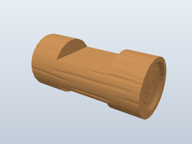  |
| `log_1insert_1-1_2_round` | 1 Insert Log (Round), 1 1/2 (169) | Round, 1 notch | | 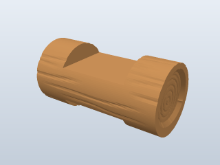 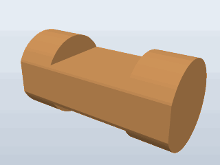 |
| `log_1insert_1-1_2_hex` | 1 Insert Log (Hex), 1 1/2 (96) | Round, 3/4 in, with six flats 0.7 mm deep: top, bottom and four diagonals. 1 notch | Listed as hex. The end grain shows flats top and bottom. A true hexagon is 1.28 mm deep at its flats; the shallower cut keeps the corners round and the sides a full 3/4 in wide, so it fits a notch like a round log | 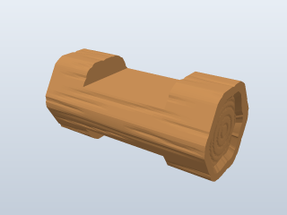 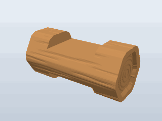 |
| `log_2insert_4-1_2` | 2 Insert Log, 4 1/2 (121) | Round, 2 notches | Photo measured 4.57 in | 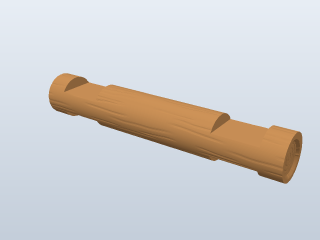 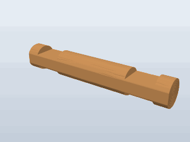 |
| `log_3insert_7-5_8` | 3 Insert Log, 7 3/4 (110) | Round, 3 notches, 7 5/8 in | The sheet says 7 3/4, but the photo measured about 7.6 in and the length rule in `PARTS_SPEC.md` (3 in centres, 7/16 in shoulders) gives 7 5/8, matching the 1 5/8 and 10 5/8 in logs from the same lot. 7 5/8 is used | 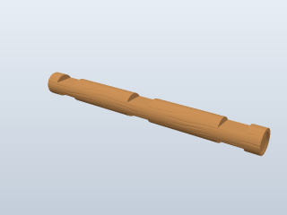 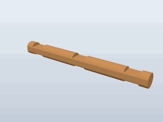 |
| `log_4insert_10-5_8` | 4 Insert Log, 10 5/8 (3) | Round, 4 notches | | 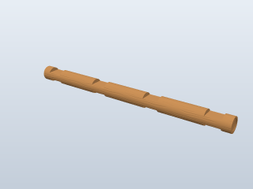 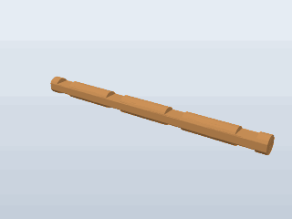 |
| `half_log_4-1_2`, `half_log_7-1_2` | Half Log, 4 1/2 (8) and 7 1/2 (10) | Flat bottom at the bottom-notch floor (9/16 in tall), notches on top only, 3/4 in wide | Photo: about 0.53 in tall. These are the base course, so a building sits flat on the table | 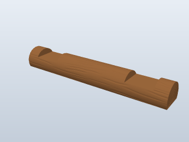 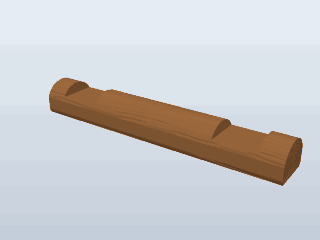 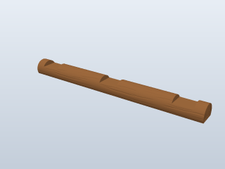 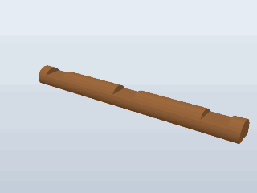 |
| `beveled_end_1-1_2` | Beveled End, 1 1/2 x 1 1/4 (19) | 1 1/2 in log, one end cut at 39 deg | The 39 deg is from the photos and matches the wooden triangle. The sheet's "1 1/4" is not explained by the photos | 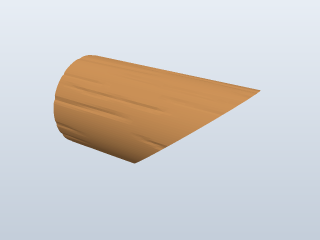 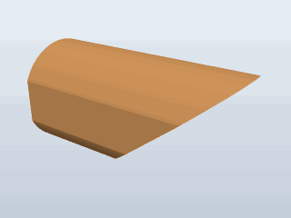 |
| `solid_log_1-3_8`, `solid_log_1-5_8` | Solid Log, 1 3/8 (30) and 1 5/8 (15) | Plain 3/4 in cylinders | Purpose unknown; not used in the test buildings | 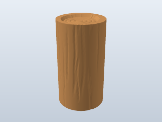 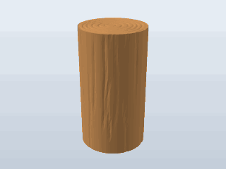 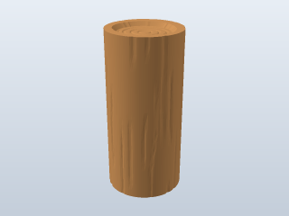 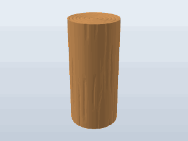 |
| `gable_plastic_8-1_2` | Plastic Orange Roof, 2 1/4 x 8 1/2 (1) | Symmetric; 3 bottom notches on 3 in centres; 7 steps per side; eave hook lips | Measured from an enlarged photo; slope 27 deg | 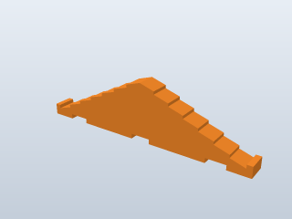  |
| `gable_plastic_small_2notch` | Not on the sheet (second photo shows 4) | Symmetric; 2 bottom notches 3 in apart; 5 steps per side; eave hook lips; 5.8 x 1.56 in | Photo: about 5.8 in wide and 1.6 in tall, notch centres about 1.4 in from each end. Same lip, riser and pitch (27 deg) as the large gable, so the height follows from the width | 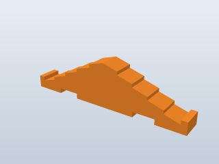 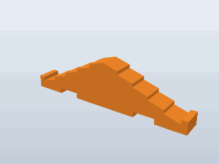 |
| `chimney` | Not on the sheet (second photo shows 2) | Open-topped block, 1 3/8 in wide x 1.2 in tall x 1 in deep, inverted-V cut in the base | Photo: about 1.39 x 1.2 in; V about 0.36 in deep with 27 deg sides, so it straddles a plastic-gable roof ridge. Modelled V: 0.35 in, matched to the 27.1 deg roof. Depth and the 1/2 in-deep top socket are not visible; my choice |  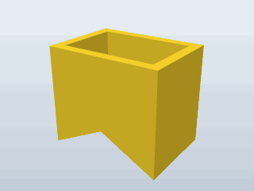 |
| `gable_wood_triangle_4x2` | Triangle, 4 x 2 (16) | Straight 39 deg slopes, 2 bottom notches 3 in apart | Listed 4 x 2; measures about 4 7/8 x 2 (notch-to-notch 3 in plus about 0.9 in overhang each side). Decorative log-row grooves not modelled | 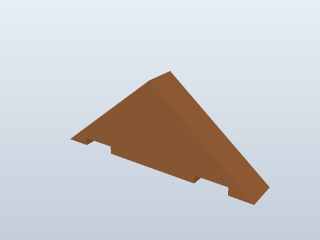 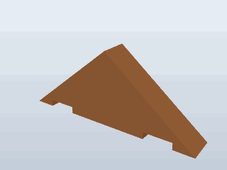 |
| `shingle_flat_6`, `_9`, `_11` | Orange/Yellow/Green Flat Shingle, 6, 9, 11 | 0.8 x 1/8 in boards | Width measured about 0.79 to 0.8 in | 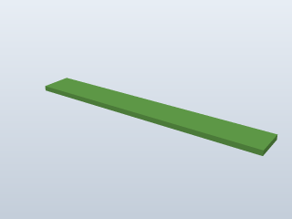 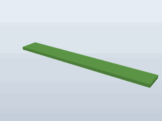 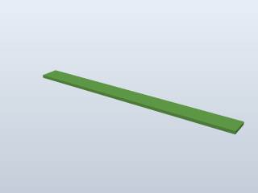 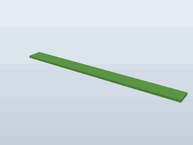 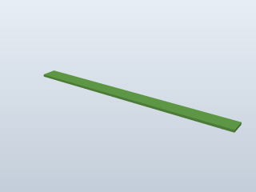 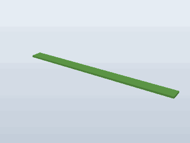 |
| `shingle_ridge_5-5_8`, `_6`, `_9` | Red/Yellow/Green with Ridge Shingle | 1 1/8 in board with a centre groove | Measured 1.13 to 1.17 in wide. Both halves are lit identically, so it is flat, not folded | 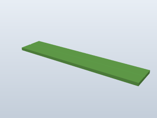 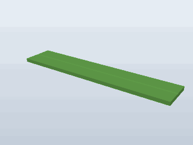 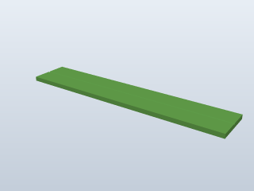 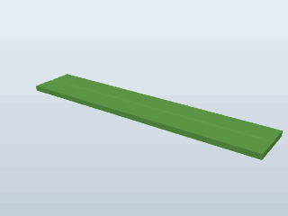 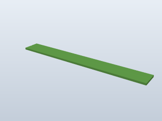  |

**Gable thickness** isn't visible in any photo. All three gables are 19.05 mm thick, the same as a log, so they fill a crossing log's notch slot the way a log does. That locks them sideways.

**Shingle thickness** is also not visible. I used 1/8 in.

**Chimney depth and socket** are also not visible, since the photo is front-on. I used 1 in deep, 0.12 in walls and a 1/2 in-deep open top.

## Rounded-end set

`stl/rounded_woodgrain/` is a separate, logs-only set: each notched log with the rounded ends of the old 4 3/4 in "beveled end" log, which has moved here as `log_2insert_4-3_4_rounded`. It is wood grain only. Build it with `makeParts({ set: 'rounded' })`; the list is `ROUNDED_LOGS` in `parts.mjs`.

| Feature | Value |
|---|---|
| End shape | The cross-section steps down to 95% of full size 1.5 mm in from the end, 82% at 3.5 mm and 66.5% at the end face (it was 60%; the first step is now a 45 deg overhang on the end that stands on the bed) (`ROUNDED_ENDS` in `parts.mjs`) |
| Lengths, notches, fit | The same as the matching standard log; the rounding sits in the end shoulders, outside the notches |
| Not included | Half logs, the 1 1/2 in slanted beveled end and the solid logs, which keep their flat ends |

| STL | Based on | Still and rotating |
|---|---|---|
| `log_1insert_1-5_8_rounded` | `log_1insert_1-5_8` | 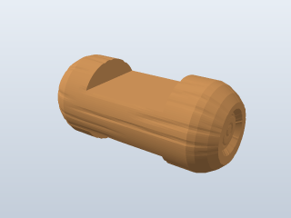 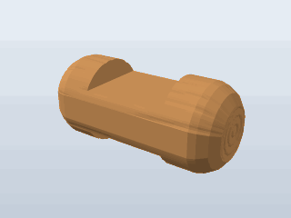 |
| `log_1insert_1-1_2_round_rounded` | `log_1insert_1-1_2_round` | 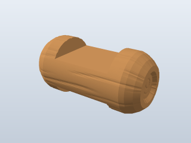 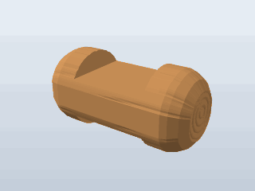 |
| `log_1insert_1-1_2_hex_rounded` | `log_1insert_1-1_2_hex` | 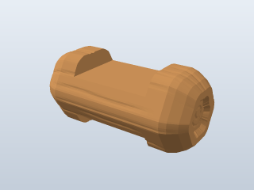  |
| `log_2insert_4-1_2_rounded` | `log_2insert_4-1_2` | 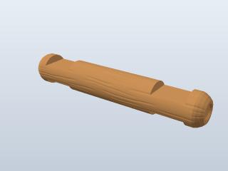 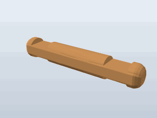 |
| `log_2insert_4-3_4_rounded` | The old `beveled_end_4-3_4` (Beveled End, 4 3/4), unchanged in shape |  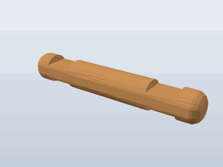 |
| `log_3insert_7-5_8_rounded` | `log_3insert_7-5_8` |  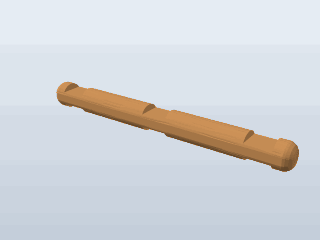 |
| `log_4insert_10-5_8_rounded` | `log_4insert_10-5_8` | 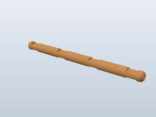 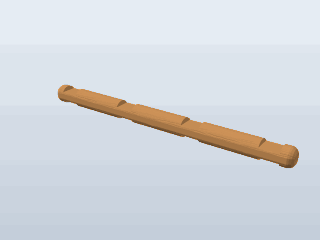 |

The rounded logs have the same notch layout as the standard logs, so they should mix into the same buildings, but `verify.mjs` only checks the standard sets. They stand on the narrowed end, 12.7 mm across, with about 59 mm2 on the bed, so they need a brim.

## Check against `PARTS_SPEC.md`

Every part was re-rendered and its dimensions compared with the spec. Two parts changed:

| Part | Was | Now | Why |
|---|---|---|---|
| 3-insert log | 7 3/4 in (1/2 in shoulders) | 7 5/8 in (7/16 in shoulders); STL renamed `log_3insert_7-5_8` | 7 3/4 fits neither column of the spec's length rule; 7 5/8 fits the 7/16 in column and the photo |
| Small plastic gable | 5 3/4 x 1.55 in | 5.8 x 1.56 in | Spec and photo give about 5.8 x 1.6 in, with notches 1.4 in from each end |

Everything else agrees with the spec within its stated confidence. Known differences that were kept:
- **End shoulders are mixed:** the 1 1/2 and 4 1/2 in logs and the half logs use 3/8 in; the 1 5/8, 7 5/8 and 10 5/8 in logs use 7/16 in. Both appear in the spec, and each length follows the reference lot.
- **Half-log height** is 9/16 in against about 0.53 in measured, so the flat sits exactly at the notch floor. The difference is inside the photo error.
- **Width across the notch faces:** the spec's 11/16 in (low confidence, from one compatible build) is not used. Logs stay 3/4 in round. Earlier versions were 18.25 mm wide where they sat in a notch because of the printing flat, with 0.2 mm clearance per side.
- **The 4 3/4 in rounded-end log** (now `log_2insert_4-3_4_rounded` in the rounded set) has 1/2 in shoulders, which doesn't follow the length rule. The 6 in 2-insert log (1 1/8 in shoulders, non-standard in the spec) has been removed.
- **Spec pieces not modelled:** the 4-notch flat log, the 1916-1920s gable logs and one-piece roof, slats of 12, 9 3/4, 7 3/4, 4 and 3 in, slat clips, and the 1990s-on molded roofs, windows and doors (no dimensions exist).

## Test buildings (verified)

`assembly.mjs` builds six buildings using only parts from the reference photos. It follows the brand's building rules:
- End walls take the even courses, starting with **half logs**.
- Side walls take the odd courses.
- Each gable sits where the next end-wall log would go, with its bottom notches dropped over the crossing side-wall logs.

| | Cabin | Shed | Cottage |
|---|---|---|---|
| Size between wall centres | 6 x 9 in | 3 x 6 in | 3 x 6 in |
| Base | `half_log_7-1_2` | `half_log_4-1_2` | `half_log_4-1_2` |
| End walls | 3-insert logs; doorway (front) and window (back) framed with 1-insert pieces, including the hex and round 1 1/2 in ones, and 2-insert logs | 2-insert 4 1/2 logs | 2-insert 4 1/2 logs |
| Side walls | 4-insert logs | 3-insert logs | 3-insert logs |
| Gables | 2 x large plastic gable | 2 x wooden triangle | 2 x small plastic gable |
| Shingles per slope | 3 flat 9 in + 1 ridge 9 in | 2 flat 6 in + 1 ridge 6 in | 3 flat 6 in |
| Chimney | Yes, on the ridge | No (its 39 deg roof doesn't match the chimney's 27 deg V) | Yes, on the ridge |

Three more buildings use the same rules and helpers:

| | Porch cabin | Tall house | Watchtower |
|---|---|---|---|
| Size between wall centres | 6 x 6 in room + 3 in porch | 6 x 6 in | 3 x 3 in |
| Courses | 8 | 12 | 14 |
| Base | 3 x `half_log_7-1_2` (the third is the porch sill) | `half_log_7-1_2` | `half_log_4-1_2` |
| Walls | 3-insert logs; the top side-wall course is 4-insert logs that run forward over two posts, each seven crossed 1-insert logs | 3-insert logs; doorway on three courses and a window in each wall, framed with 1- and 2-insert logs | 2-insert logs; five look-out slits, each a pair of 1-insert logs |
| Gables | 2 x large plastic gable (one over the porch) | 2 x large plastic gable | 2 x wooden triangle |
| Shingles | 9 in, flush with the gables | 9 in, overhanging 1 1/2 in at each gable | 6 in, overhanging 1 1/2 in at each gable |
| Chimney | Yes | Yes | No |

**The chimney is placed the same way as a real one would settle.** It is centred on the ridge and lowered until its V-cut base first touches the shingles.

**Shingle positions are computed, not placed by hand.** Each shingle is lowered onto the gable's top edge, the way a real board settles:
1. Its lower edge starts just clear of the eave lip or the shingle below.
2. It rotates down until it touches the edge again.
3. If its centre of mass would be past that second contact, it tips forward until its far edge lands.

The layout that reaches closest to the peak without crossing it is kept. On the stepped plastic gable this gives a slightly stepped, overlapping-looking roof, as in the photos.

### What `verify.mjs` checks

Each placed part is voxelised at 0.5 mm, from the same geometry as the STLs. Then:
- **Interference:** volume shared between parts; any shared voxel counts. Result: **none, in all six buildings**. Parts touch but never overlap.
- **Support:** each part's centre of mass must lie inside the convex hull of its contacts below. A contact means another part, or the table, within 1 mm (two voxels) directly below. One voxel isn't enough, because rounding to a 0.5 mm grid can open a false gap at a line contact, such as a shingle corner resting on a step. Result: **every part supported**. Only the half logs touch the table, so every building sits flat.
- **Wood grain** needs no supports. Finer layers (0.12 to 0.16 mm) show the grain on top of the logs better. Textured log STLs are 1 to 2.5 MB each.
- **Chimney:** the STL is upside down, open top on the bed and V facing up.
- **Long parts:** the 4-insert log stands 270 mm tall and needs a printer with that much height. The 11 in shingle (279 mm) needs a large bed or a diagonal layout.
- **PETG:** regenerate with `--clearance 0.3`.

## Legal

The 1920 patent has expired, so the geometry is free to copy. "Lincoln Logs" is a registered Hasbro trademark ([Justia](https://trademarks.justia.com/715/38/lincoln-logs-71538955.html)), so the name is not. If you share or sell the files or prints, call them "compatible log-cabin logs".
