# Parts catalogue

Every printable part, with a picture and a link to its STL. All files are in millimetres and already lie in their printing orientation, so they need no rotation and no supports.

A building needs the [roof parts](#roof-parts) plus the logs from **one** of the four log sets. Every log set holds the same 11 logs with the same notches, so the sets can be mixed in one building. Each set also has the 4-notch log as [two halves](README.md#the-two-piece-4-notch-log) that join with a dovetail, for printers with a bed shorter than 270 mm. An extender that goes between the halves makes longer logs.

| Jump to | Folder | Parts |
|---|---|:---:|
| [Log download table](#the-11-logs) | All four log sets side by side | 44 |
| [Roof parts](#roof-parts) | [`stl/roof_parts/`](stl/roof_parts) | 12 |
| [Flat-End-Round logs](#flat-end-round) | [`stl/flat_end_round/`](stl/flat_end_round) | 11 |
| [Ball-End-Round logs](#ball-end-round) | [`stl/ball_end_round/`](stl/ball_end_round) | 11 |
| [Flat-End-Octagonal logs](#flat-end-octagonal) | [`stl/flat_end_octagonal/`](stl/flat_end_octagonal) | 11 |
| [Smooth logs](#smooth) | [`stl/smooth/`](stl/smooth) | 11 |

To download one file from GitHub, follow its link and press **Download raw file**. To get everything, use **Code > Download ZIP** on the repository page. For slicer settings and how many of each part a building needs, see the [README](README.md#how-to-print). For how each part was measured, see the [design notes](DESIGN_NOTES.md#measurement-notes-by-part).

## The 11 logs

Each row is one log; each link is that log in one of the four finishes.

| Log | Length | What it is | Flat-End-Round | Ball-End-Round | Flat-End-Octagonal | Smooth |
|---|---|---|:---:|:---:|:---:|:---:|
| **1-notch log** | 1 5/8 in (41 mm) | Round, one notch | [STL](stl/flat_end_round/log_1insert_1-5_8.stl) | [STL](stl/ball_end_round/log_1insert_1-5_8_rounded.stl) | [STL](stl/flat_end_octagonal/log_1insert_1-5_8_oct.stl) | [STL](stl/smooth/log_1insert_1-5_8.stl) |
| **1-notch log, short** | 1 1/2 in (38 mm) | Round, one notch | [STL](stl/flat_end_round/log_1insert_1-1_2_round.stl) | [STL](stl/ball_end_round/log_1insert_1-1_2_round_rounded.stl) | [STL](stl/flat_end_octagonal/log_1insert_1-1_2_oct.stl) | [STL](stl/smooth/log_1insert_1-1_2_round.stl) |
| **1-notch log, octagonal** | 1 1/2 in (38 mm) | Eight-sided in every set (the original is sold as "hex") | [STL](stl/flat_end_round/log_1insert_1-1_2_octagonal.stl) | [STL](stl/ball_end_round/log_1insert_1-1_2_octagonal_rounded.stl) | [STL](stl/flat_end_octagonal/log_1insert_1-1_2_octagonal_oct.stl) | [STL](stl/smooth/log_1insert_1-1_2_octagonal.stl) |
| **2-notch log** | 4 1/2 in (114 mm) | Round, two notches | [STL](stl/flat_end_round/log_2insert_4-1_2.stl) | [STL](stl/ball_end_round/log_2insert_4-1_2_rounded.stl) | [STL](stl/flat_end_octagonal/log_2insert_4-1_2_oct.stl) | [STL](stl/smooth/log_2insert_4-1_2.stl) |
| **3-notch log** | 7 5/8 in (194 mm) | Round, three notches | [STL](stl/flat_end_round/log_3insert_7-5_8.stl) | [STL](stl/ball_end_round/log_3insert_7-5_8_rounded.stl) | [STL](stl/flat_end_octagonal/log_3insert_7-5_8_oct.stl) | [STL](stl/smooth/log_3insert_7-5_8.stl) |
| **4-notch log** | 10 5/8 in (270 mm) | Round, four notches. Longer than a 256 mm bed | [STL](stl/flat_end_round/log_4insert_10-5_8.stl) | [STL](stl/ball_end_round/log_4insert_10-5_8_rounded.stl) | [STL](stl/flat_end_octagonal/log_4insert_10-5_8_oct.stl) | [STL](stl/smooth/log_4insert_10-5_8.stl) |
| **4-notch log, tongue half** | 5 7/16 in (138 mm) | Half of the 4-notch log, with the dovetail tail. Print one of each half in place of a whole log | [STL](stl/flat_end_round/log_4insert_10-5_8_split_tongue.stl) | [STL](stl/ball_end_round/log_4insert_10-5_8_split_tongue_rounded.stl) | [STL](stl/flat_end_octagonal/log_4insert_10-5_8_split_tongue_oct.stl) | [STL](stl/smooth/log_4insert_10-5_8_split_tongue.stl) |
| **4-notch log, groove half** | 5 7/16 in (138 mm) | The other half, with the dovetail socket | [STL](stl/flat_end_round/log_4insert_10-5_8_split_groove.stl) | [STL](stl/ball_end_round/log_4insert_10-5_8_split_groove_rounded.stl) | [STL](stl/flat_end_octagonal/log_4insert_10-5_8_split_groove_oct.stl) | [STL](stl/smooth/log_4insert_10-5_8_split_groove.stl) |
| **Extender, 1 notch** | 3 1/4 in (82 mm) | Goes between the two halves; each one adds a notch and 3 in | [STL](stl/flat_end_round/log_extender_1insert_3.stl) | [STL](stl/ball_end_round/log_extender_1insert_3_rounded.stl) | [STL](stl/flat_end_octagonal/log_extender_1insert_3_oct.stl) | [STL](stl/smooth/log_extender_1insert_3.stl) |
| **Half log, 2 notches** | 4 1/2 in (114 mm) | Flat underneath, notches on top; the base course | [STL](stl/flat_end_round/half_log_4-1_2.stl) | [STL](stl/ball_end_round/half_log_4-1_2_rounded.stl) | [STL](stl/flat_end_octagonal/half_log_4-1_2_oct.stl) | [STL](stl/smooth/half_log_4-1_2.stl) |
| **Half log, 3 notches** | 7 1/2 in (191 mm) | Flat underneath, notches on top; the base course | [STL](stl/flat_end_round/half_log_7-1_2.stl) | [STL](stl/ball_end_round/half_log_7-1_2_rounded.stl) | [STL](stl/flat_end_octagonal/half_log_7-1_2_oct.stl) | [STL](stl/smooth/half_log_7-1_2.stl) |
| **Beveled end** | 1 1/2 in (38 mm) | One notch, one end cut at 39 deg | [STL](stl/flat_end_round/beveled_end_1-1_2.stl) | [STL](stl/ball_end_round/beveled_end_1-1_2_rounded.stl) | [STL](stl/flat_end_octagonal/beveled_end_1-1_2_oct.stl) | [STL](stl/smooth/beveled_end_1-1_2.stl) |
| **Solid log** | 1 3/8 in (35 mm) | No notches; prints standing on end | [STL](stl/flat_end_round/solid_log_1-3_8.stl) | [STL](stl/ball_end_round/solid_log_1-3_8_rounded.stl) | [STL](stl/flat_end_octagonal/solid_log_1-3_8_oct.stl) | [STL](stl/smooth/solid_log_1-3_8.stl) |
| **Solid log** | 1 5/8 in (41 mm) | No notches; prints standing on end | [STL](stl/flat_end_round/solid_log_1-5_8.stl) | [STL](stl/ball_end_round/solid_log_1-5_8_rounded.stl) | [STL](stl/flat_end_octagonal/solid_log_1-5_8_oct.stl) | [STL](stl/smooth/solid_log_1-5_8.stl) |

Round logs are 3/4 in (19.05 mm) in diameter with a 0.4 mm flat on each side, so every log is 18.25 mm wide where it sits in a notch. Notches are 3 in apart, and each crossing course adds 3/8 in of height.

## Roof parts

[`stl/roof_parts/`](stl/roof_parts): gables, shingles, the chimney, and a door and window. These are smooth, and the same whichever log set you print.

| Part | Size | What it is | STL | Still and rotating |
|---|---|---|---|---|
| **Large stepped gable** | 216 x 57 x 18.3 mm | Three bottom notches, seven steps a side, 27 deg pitch. Spans a 6 in wall | [`gable_plastic_8-1_2.stl`](stl/roof_parts/gable_plastic_8-1_2.stl) | 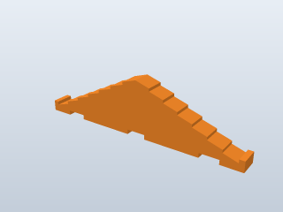  |
| **Small stepped gable** | 147 x 40 x 18.3 mm | Two bottom notches, five steps a side, 27 deg pitch. Spans a 3 in wall | [`gable_plastic_small_2notch.stl`](stl/roof_parts/gable_plastic_small_2notch.stl) | 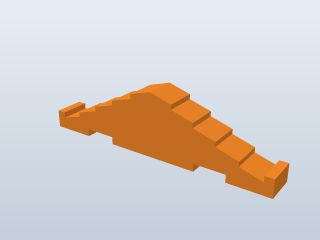 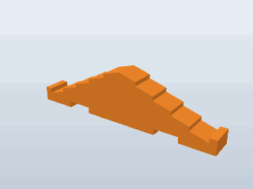 |
| **Triangle gable** | 124 x 51 x 18.3 mm | Two bottom notches, straight 39 deg slopes. Spans a 3 in wall | [`gable_wood_triangle_4x2.stl`](stl/roof_parts/gable_wood_triangle_4x2.stl) | 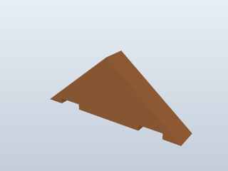 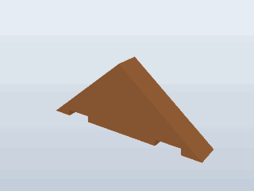 |
| **Flat shingle, 6 in** | 152 x 20 x 3.2 mm | Plain roof board | [`shingle_flat_6.stl`](stl/roof_parts/shingle_flat_6.stl) |  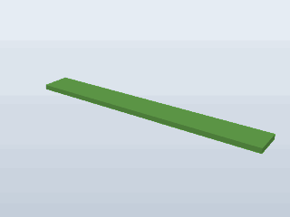 |
| **Flat shingle, 9 in** | 229 x 20 x 3.2 mm | Plain roof board | [`shingle_flat_9.stl`](stl/roof_parts/shingle_flat_9.stl) |   |
| **Flat shingle, 11 in** | 279 x 20 x 3.2 mm | Plain roof board. Longer than a 256 mm bed | [`shingle_flat_11.stl`](stl/roof_parts/shingle_flat_11.stl) | 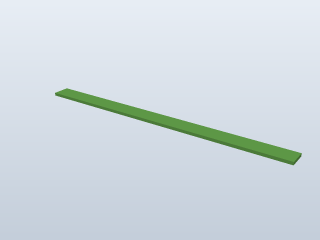 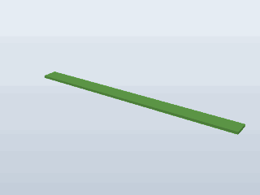 |
| **Ridge shingle, 5 5/8 in** | 143 x 29 x 3.2 mm | Wider board with a centre groove | [`shingle_ridge_5-5_8.stl`](stl/roof_parts/shingle_ridge_5-5_8.stl) | 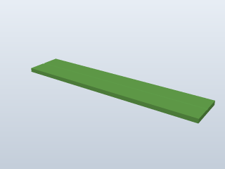  |
| **Ridge shingle, 6 in** | 152 x 29 x 3.2 mm | Wider board with a centre groove | [`shingle_ridge_6.stl`](stl/roof_parts/shingle_ridge_6.stl) | 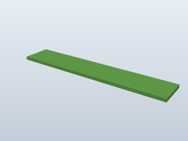 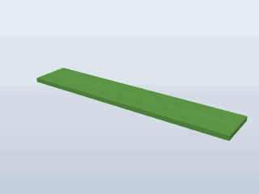 |
| **Ridge shingle, 9 in** | 229 x 29 x 3.2 mm | Wider board with a centre groove | [`shingle_ridge_9.stl`](stl/roof_parts/shingle_ridge_9.stl) |   |
| **Chimney** | 35 x 25 x 30 mm | Open top, V-cut base that sits astride the ridge of a stepped-gable roof | [`chimney.stl`](stl/roof_parts/chimney.stl) |  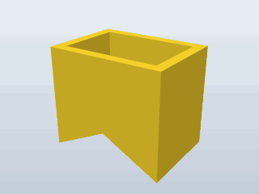 |
| **Door** | 57 x 47 x 3.2 mm | Stands in a wall opening four courses high. Not a copy of an original part | [`extra_door.stl`](stl/roof_parts/extra_door.stl) | No picture |
| **Window** | 57 x 38 x 3.2 mm | Stands in a wall opening three courses high. Not a copy of an original part | [`extra_window.stl`](stl/roof_parts/extra_window.stl) | No picture |

The chimney fits the two stepped gables only; the triangle gable's roof is steeper than the chimney's V.

## Flat-End-Round

[`stl/flat_end_round/`](stl/flat_end_round). Round logs with grain along their length and growth rings on flat ends. The closest match to the wooden originals, and the set used in the pictures of the example buildings.

| Log | Length | STL | Still and rotating |
|---|---|---|---|
| **1-notch log** | 1 5/8 in (41 mm) | [`log_1insert_1-5_8.stl`](stl/flat_end_round/log_1insert_1-5_8.stl) | 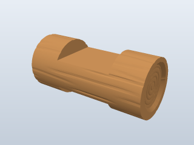 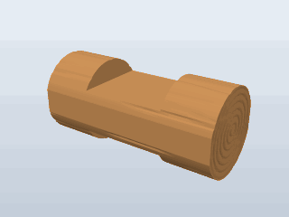 |
| **1-notch log, short** | 1 1/2 in (38 mm) | [`log_1insert_1-1_2_round.stl`](stl/flat_end_round/log_1insert_1-1_2_round.stl) | 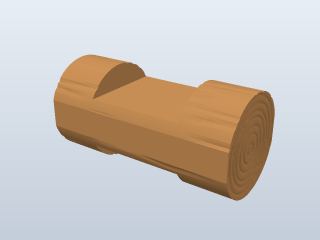  |
| **1-notch log, octagonal** | 1 1/2 in (38 mm) | [`log_1insert_1-1_2_octagonal.stl`](stl/flat_end_round/log_1insert_1-1_2_octagonal.stl) | 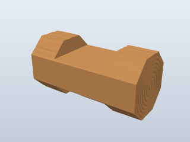  |
| **2-notch log** | 4 1/2 in (114 mm) | [`log_2insert_4-1_2.stl`](stl/flat_end_round/log_2insert_4-1_2.stl) | 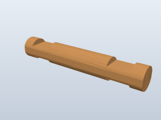  |
| **3-notch log** | 7 5/8 in (194 mm) | [`log_3insert_7-5_8.stl`](stl/flat_end_round/log_3insert_7-5_8.stl) | 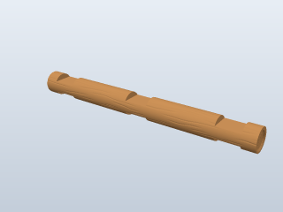  |
| **4-notch log** | 10 5/8 in (270 mm) | [`log_4insert_10-5_8.stl`](stl/flat_end_round/log_4insert_10-5_8.stl) | 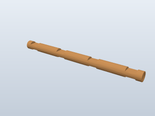 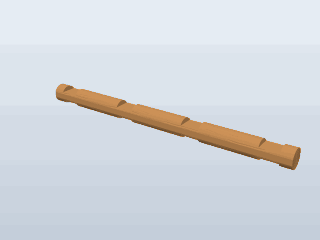 |
| **4-notch log, tongue half** | 5 7/16 in (138 mm) | [`log_4insert_10-5_8_split_tongue.stl`](stl/flat_end_round/log_4insert_10-5_8_split_tongue.stl) |  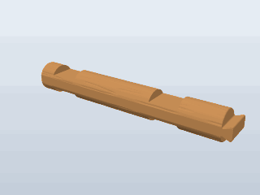 |
| **4-notch log, groove half** | 5 7/16 in (138 mm) | [`log_4insert_10-5_8_split_groove.stl`](stl/flat_end_round/log_4insert_10-5_8_split_groove.stl) |  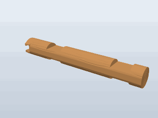 |
| **Extender, 1 notch** | 3 1/4 in (82 mm) | [`log_extender_1insert_3.stl`](stl/flat_end_round/log_extender_1insert_3.stl) | 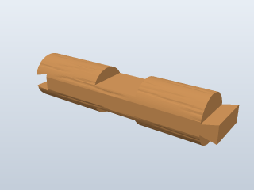  |
| **Half log, 2 notches** | 4 1/2 in (114 mm) | [`half_log_4-1_2.stl`](stl/flat_end_round/half_log_4-1_2.stl) | 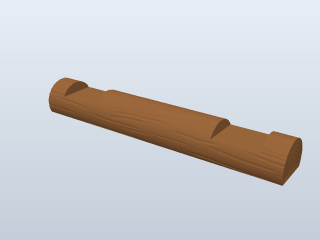  |
| **Half log, 3 notches** | 7 1/2 in (191 mm) | [`half_log_7-1_2.stl`](stl/flat_end_round/half_log_7-1_2.stl) | 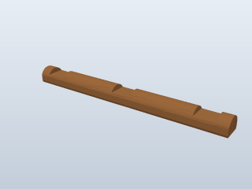 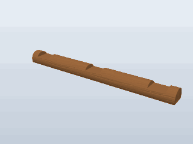 |
| **Beveled end** | 1 1/2 in (38 mm) | [`beveled_end_1-1_2.stl`](stl/flat_end_round/beveled_end_1-1_2.stl) | 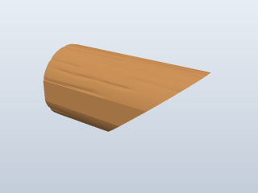 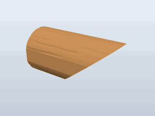 |
| **Solid log** | 1 3/8 in (35 mm) | [`solid_log_1-3_8.stl`](stl/flat_end_round/solid_log_1-3_8.stl) | 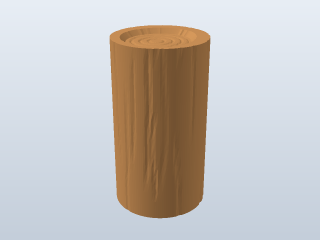 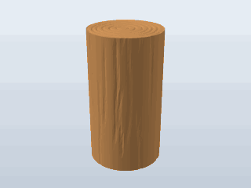 |
| **Solid log** | 1 5/8 in (41 mm) | [`solid_log_1-5_8.stl`](stl/flat_end_round/solid_log_1-5_8.stl) | 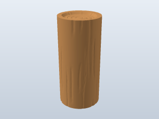 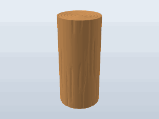 |

[Back to top](#parts-catalogue)

## Ball-End-Round

[`stl/ball_end_round/`](stl/ball_end_round). The same round, wood-grain logs with their ends rounded over. File names end in `_rounded`. The last 1.5 mm of each end lifts slightly off the bed; it prints without supports.

| Log | Length | STL | Still and rotating |
|---|---|---|---|
| **1-notch log** | 1 5/8 in (41 mm) | [`log_1insert_1-5_8_rounded.stl`](stl/ball_end_round/log_1insert_1-5_8_rounded.stl) | 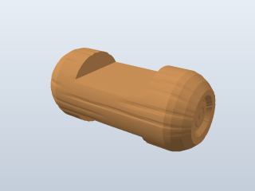  |
| **1-notch log, short** | 1 1/2 in (38 mm) | [`log_1insert_1-1_2_round_rounded.stl`](stl/ball_end_round/log_1insert_1-1_2_round_rounded.stl) | 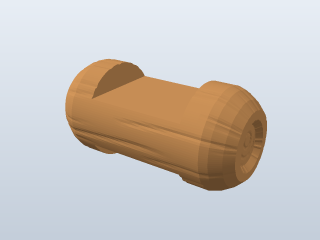 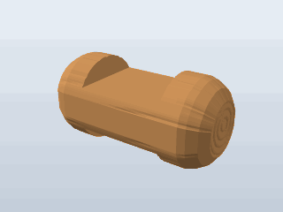 |
| **1-notch log, octagonal** | 1 1/2 in (38 mm) | [`log_1insert_1-1_2_octagonal_rounded.stl`](stl/ball_end_round/log_1insert_1-1_2_octagonal_rounded.stl) | 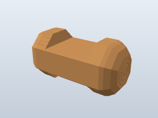  |
| **2-notch log** | 4 1/2 in (114 mm) | [`log_2insert_4-1_2_rounded.stl`](stl/ball_end_round/log_2insert_4-1_2_rounded.stl) |  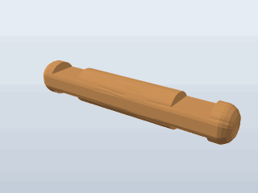 |
| **3-notch log** | 7 5/8 in (194 mm) | [`log_3insert_7-5_8_rounded.stl`](stl/ball_end_round/log_3insert_7-5_8_rounded.stl) |  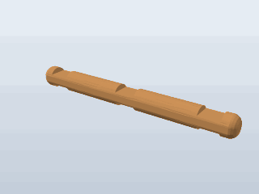 |
| **4-notch log** | 10 5/8 in (270 mm) | [`log_4insert_10-5_8_rounded.stl`](stl/ball_end_round/log_4insert_10-5_8_rounded.stl) | 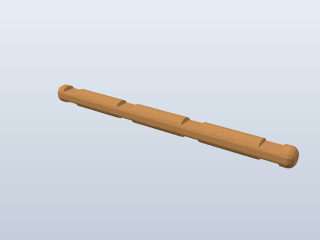 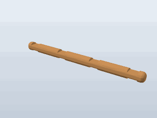 |
| **4-notch log, tongue half** | 5 7/16 in (138 mm) | [`log_4insert_10-5_8_split_tongue_rounded.stl`](stl/ball_end_round/log_4insert_10-5_8_split_tongue_rounded.stl) | 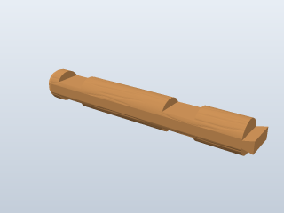 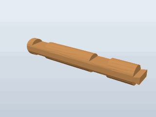 |
| **4-notch log, groove half** | 5 7/16 in (138 mm) | [`log_4insert_10-5_8_split_groove_rounded.stl`](stl/ball_end_round/log_4insert_10-5_8_split_groove_rounded.stl) | 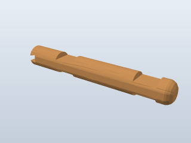 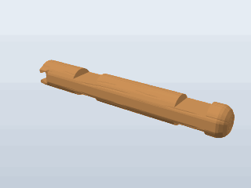 |
| **Extender, 1 notch** | 3 1/4 in (82 mm) | [`log_extender_1insert_3_rounded.stl`](stl/ball_end_round/log_extender_1insert_3_rounded.stl) |  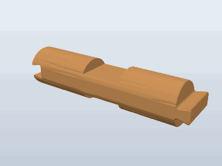 |
| **Half log, 2 notches** | 4 1/2 in (114 mm) | [`half_log_4-1_2_rounded.stl`](stl/ball_end_round/half_log_4-1_2_rounded.stl) | 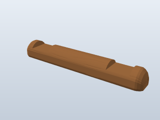 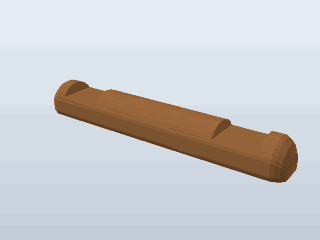 |
| **Half log, 3 notches** | 7 1/2 in (191 mm) | [`half_log_7-1_2_rounded.stl`](stl/ball_end_round/half_log_7-1_2_rounded.stl) | 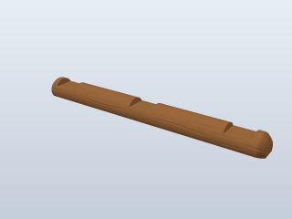  |
| **Beveled end** | 1 1/2 in (38 mm) | [`beveled_end_1-1_2_rounded.stl`](stl/ball_end_round/beveled_end_1-1_2_rounded.stl) | 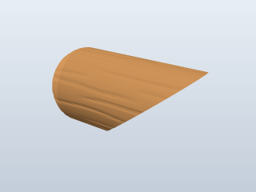  |
| **Solid log** | 1 3/8 in (35 mm) | [`solid_log_1-3_8_rounded.stl`](stl/ball_end_round/solid_log_1-3_8_rounded.stl) | 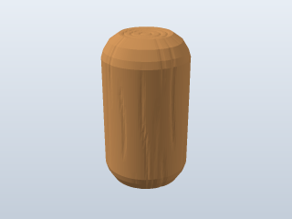  |
| **Solid log** | 1 5/8 in (41 mm) | [`solid_log_1-5_8_rounded.stl`](stl/ball_end_round/solid_log_1-5_8_rounded.stl) |   |

[Back to top](#parts-catalogue)

## Flat-End-Octagonal

[`stl/flat_end_octagonal/`](stl/flat_end_octagonal). Eight-sided logs with wood grain and flat ends. File names end in `_oct`. Both 1 1/2 in logs are octagonal here, so the one that is round in the other sets is named `log_1insert_1-1_2_oct`.

| Log | Length | STL | Still and rotating |
|---|---|---|---|
| **1-notch log** | 1 5/8 in (41 mm) | [`log_1insert_1-5_8_oct.stl`](stl/flat_end_octagonal/log_1insert_1-5_8_oct.stl) |   |
| **1-notch log, short** | 1 1/2 in (38 mm) | [`log_1insert_1-1_2_oct.stl`](stl/flat_end_octagonal/log_1insert_1-1_2_oct.stl) |   |
| **1-notch log, octagonal** | 1 1/2 in (38 mm) | [`log_1insert_1-1_2_octagonal_oct.stl`](stl/flat_end_octagonal/log_1insert_1-1_2_octagonal_oct.stl) |   |
| **2-notch log** | 4 1/2 in (114 mm) | [`log_2insert_4-1_2_oct.stl`](stl/flat_end_octagonal/log_2insert_4-1_2_oct.stl) |   |
| **3-notch log** | 7 5/8 in (194 mm) | [`log_3insert_7-5_8_oct.stl`](stl/flat_end_octagonal/log_3insert_7-5_8_oct.stl) |   |
| **4-notch log** | 10 5/8 in (270 mm) | [`log_4insert_10-5_8_oct.stl`](stl/flat_end_octagonal/log_4insert_10-5_8_oct.stl) |   |
| **4-notch log, tongue half** | 5 7/16 in (138 mm) | [`log_4insert_10-5_8_split_tongue_oct.stl`](stl/flat_end_octagonal/log_4insert_10-5_8_split_tongue_oct.stl) |   |
| **4-notch log, groove half** | 5 7/16 in (138 mm) | [`log_4insert_10-5_8_split_groove_oct.stl`](stl/flat_end_octagonal/log_4insert_10-5_8_split_groove_oct.stl) |   |
| **Extender, 1 notch** | 3 1/4 in (82 mm) | [`log_extender_1insert_3_oct.stl`](stl/flat_end_octagonal/log_extender_1insert_3_oct.stl) |   |
| **Half log, 2 notches** | 4 1/2 in (114 mm) | [`half_log_4-1_2_oct.stl`](stl/flat_end_octagonal/half_log_4-1_2_oct.stl) |   |
| **Half log, 3 notches** | 7 1/2 in (191 mm) | [`half_log_7-1_2_oct.stl`](stl/flat_end_octagonal/half_log_7-1_2_oct.stl) |   |
| **Beveled end** | 1 1/2 in (38 mm) | [`beveled_end_1-1_2_oct.stl`](stl/flat_end_octagonal/beveled_end_1-1_2_oct.stl) |   |
| **Solid log** | 1 3/8 in (35 mm) | [`solid_log_1-3_8_oct.stl`](stl/flat_end_octagonal/solid_log_1-3_8_oct.stl) |   |
| **Solid log** | 1 5/8 in (41 mm) | [`solid_log_1-5_8_oct.stl`](stl/flat_end_octagonal/solid_log_1-5_8_oct.stl) |   |

[Back to top](#parts-catalogue)

## Smooth

[`stl/smooth/`](stl/smooth). Round logs with flat ends and no texture: the same shapes and file names as Flat-End-Round, in much smaller files (under 0.2 MB each, against 1 to 2.5 MB).

| Log | Length | STL |
|---|---|---|
| **1-notch log** | 1 5/8 in (41 mm) | [`log_1insert_1-5_8.stl`](stl/smooth/log_1insert_1-5_8.stl) |
| **1-notch log, short** | 1 1/2 in (38 mm) | [`log_1insert_1-1_2_round.stl`](stl/smooth/log_1insert_1-1_2_round.stl) |
| **1-notch log, octagonal** | 1 1/2 in (38 mm) | [`log_1insert_1-1_2_octagonal.stl`](stl/smooth/log_1insert_1-1_2_octagonal.stl) |
| **2-notch log** | 4 1/2 in (114 mm) | [`log_2insert_4-1_2.stl`](stl/smooth/log_2insert_4-1_2.stl) |
| **3-notch log** | 7 5/8 in (194 mm) | [`log_3insert_7-5_8.stl`](stl/smooth/log_3insert_7-5_8.stl) |
| **4-notch log** | 10 5/8 in (270 mm) | [`log_4insert_10-5_8.stl`](stl/smooth/log_4insert_10-5_8.stl) |
| **4-notch log, tongue half** | 5 7/16 in (138 mm) | [`log_4insert_10-5_8_split_tongue.stl`](stl/smooth/log_4insert_10-5_8_split_tongue.stl) |
| **4-notch log, groove half** | 5 7/16 in (138 mm) | [`log_4insert_10-5_8_split_groove.stl`](stl/smooth/log_4insert_10-5_8_split_groove.stl) |
| **Extender, 1 notch** | 3 1/4 in (82 mm) | [`log_extender_1insert_3.stl`](stl/smooth/log_extender_1insert_3.stl) |
| **Half log, 2 notches** | 4 1/2 in (114 mm) | [`half_log_4-1_2.stl`](stl/smooth/half_log_4-1_2.stl) |
| **Half log, 3 notches** | 7 1/2 in (191 mm) | [`half_log_7-1_2.stl`](stl/smooth/half_log_7-1_2.stl) |
| **Beveled end** | 1 1/2 in (38 mm) | [`beveled_end_1-1_2.stl`](stl/smooth/beveled_end_1-1_2.stl) |
| **Solid log** | 1 3/8 in (35 mm) | [`solid_log_1-3_8.stl`](stl/smooth/solid_log_1-3_8.stl) |
| **Solid log** | 1 5/8 in (41 mm) | [`solid_log_1-5_8.stl`](stl/smooth/solid_log_1-5_8.stl) |

These look like the [Flat-End-Round](#flat-end-round) logs without the grain.

[Back to top](#parts-catalogue)
