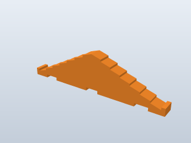
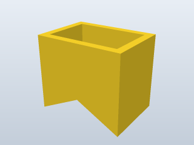
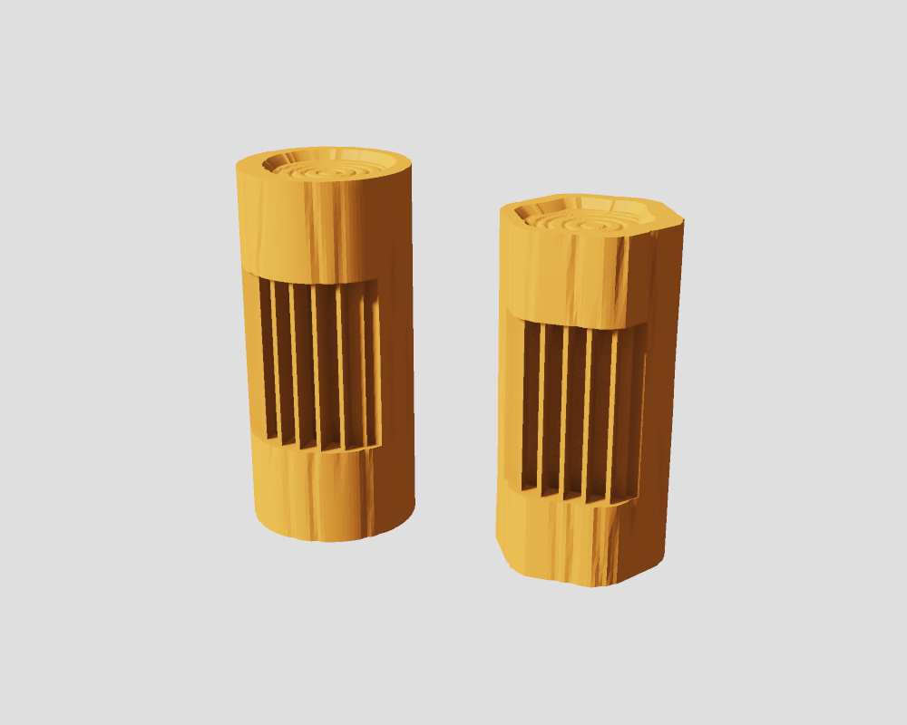

# Printable logs for the classic log building toy

3D-printable logs, gables, shingles and a chimney, sized to match the original wooden and plastic pieces. Print replacements, extend a set you own, or print a whole building.


> **Only the notch fit has been test-printed.** Two crossed 1-notch logs in PLA fit well at the current notch width. The three buildings above and the three [further down](#more-buildings) are checked in software for overlap, support and interlocking, but nobody has printed a whole building yet. Do the [fit test](#2-print-the-fit-test) on your own printer before printing a full set.

> **This branch (`vertical-print-logs`): the round logs print standing on end.** The notched logs, the hex log, the beveled end and the solid logs are redesigned for it, and none of them has been printed this way yet. What changed is in [Logs that stand on end](#logs-that-stand-on-end).

## The parts

Every STL is in millimetres and already lies in its printing orientation.

| Logs | Half logs | Gables | Shingles | Chimney |
|:---:|:---:|:---:|:---:|:---:|
|  |  |  |  |  |
| 1 to 4 notches, 1 1/2 to 10 5/8 in | 4 1/2 and 7 1/2 in; the base course | Two stepped sizes and a plain triangle | Flat and ridge, 5 5/8 to 11 in | Sits astride the roof ridge |

Also included: two solid logs, a short beveled end, and a door and window of my own design (not copies of an original). Pictures and measurements of every part are in [DESIGN_NOTES.md](DESIGN_NOTES.md#every-part).

The files are in five folders under `stl/`: one of roof parts that every building uses, and four sets of logs to choose from.

| Folder | Contents | Looks like |
|---|---|:---:|
| [`stl/roof_parts/`](stl/roof_parts) | **Roof Parts.** The 3 gables, 6 shingles and chimney, plus the door and window (12 parts). Smooth; the same whichever logs you print |  |
| [`stl/ball_end_round/`](stl/ball_end_round) | **Ball-End-Round.** All 11 logs, round, with rounded ends and wood grain (was `rounded_woodgrain`) |  |
| [`stl/flat_end_round/`](stl/flat_end_round) | **Flat-End-Round.** All 11 logs, round, with grain along them and growth rings sunk into their flat ends (was `woodgrain`) |  |
| [`stl/flat_end_octagonal/`](stl/flat_end_octagonal) | **Flat-End-Octagonal.** All 11 logs with an eight-sided section, wood grain and flat ends |  |
| [`stl/smooth/`](stl/smooth) | **Smooth.** All 11 logs, round and plain. Small files | |

To print a building, take everything you need from `roof_parts` and the logs from one set. Every log set has the same 11 logs, named after the flat-end round ones with `_rounded` or `_oct` added (the octagonal 1 1/2 in log is `log_1insert_1-1_2_oct`). All four log sets have the same notches and the same 3/4 in width where they sit in a notch, so they can be mixed in one building. The grain is cut into the surface, never raised, so sizes and notch fit don't change. An octagonal log is 3/4 in across its flats, so it is as wide as a round one.

## How to print

### 1. Get the files

On GitHub, choose **Code > Download ZIP** and unzip it, or clone the repository. You only need the `stl/` folder: `roof_parts` plus one of the four log sets above.

### 2. Print the fit test

Printers and filaments vary, so check the notch fit before printing a building. Print:

- 2 x `log_1insert_1-5_8`
- 1 x `half_log_4-1_2`

Cross the two logs at their notches, then seat one in a half-log notch. A log should seat fully and lift out freely, without rattling.

- **Too tight or too loose:** a notch is 19.45 mm wide and the part that sits in it is a full 19.05 mm (3/4 in) wide, which leaves 0.2 mm clearance per side. In a PLA test print of the earlier lying-down logs, 0.2 mm per side seated fully with a small amount of play. Change the clearance in 0.05 mm steps with `--clearance` (see [Regenerating the files](#regenerating-the-files)) or the `Clearance` parameter in the [Fusion design](fusion/README.md).
- **PETG:** start at 0.3 mm.
- **That test was printed with the logs lying down.** Standing logs keep the same clearance, but they are now fully round and the notch width runs up the layers, so repeat the test before printing a set.

### 3. Slice

Load the STLs as they are: no rotation and no supports.

| Setting | Value |
|---|---|
| Nozzle | 0.4 mm |
| Layer height | 0.2 mm. Use 0.12 to 0.16 mm to show the wood grain better |
| Walls | 3 or more |
| Infill | 20 to 30% |
| Supports | None from the slicer. The standing logs carry their own break-away supports in the notches |
| Brim | 5 mm on standing logs taller than about 100 mm, and on all ball-end logs |
| Material | PLA. For PETG, use 0.3 mm clearance (step 2) |

How each part sits on the bed:

| Part | Orientation in the STL |
|---|---|
| Round, hex and octagonal logs, beveled ends | Standing on end |
| Half logs | Flat side down, notches up |
| Solid logs | Standing on end |
| Gables, shingles, door, window | Flat on a face |
| Chimney | Upside down: open top on the bed, V-cut facing up |

**Bed size and height.** `log_4insert_10-5_8` stands 270 mm tall, which is more than a 256 mm printer can build; it needs a taller printer. The 3-notch log stands 194 mm tall. `shingle_flat_11` (279 mm) is longer than a 256 mm bed: turn it diagonally.

**Ball-end logs.** They stand on a 12.7 mm end, so only about 59 mm2 touches the bed. Use a brim.

**Octagonal logs** print the same way as the round ones, standing on a flat end with the support combs in their notches.

### Logs that stand on end

| Feature | What it is |
|---|---|
| Shape | A full 3/4 in circle from end to end: no printing flat and no trimmed sides. The hex log is the same circle with six shallow flats 0.7 mm deep. The octagonal logs are a regular octagon 3/4 in across the flats |
| Notches | Square walls, 19.45 mm apart. The upper wall of each notch is a flat overhang as printed, so each notch has a built-in support |
| Built-in supports | A comb of five 0.5 mm fins in every notch, standing on the lower wall and stopping 0.2 mm under the upper one. It keeps 0.5 mm away from the notch floor and 0.4 mm inside the log's surface |
| Ends, wood grain | The growth rings sit in a hollow 1 mm deep. Round it is a flat rim 1.2 to 2.8 mm wide, thick on one side and thin on the other like the wall of a hollow log. Only the rim touches the bed (about 106 mm2) |
| Ends, smooth | Flat |



**Removing the supports.** Grip a comb across its fins with needle-nose pliers and twist; it is joined to the log only along the foot of its fins. Scrape the lower notch wall flat if a ridge is left. To print without them, or with your slicer's supports instead, regenerate with `--supports 0`.

Two things to expect on the end that sits on the bed: the floor of the hollow is a 13 mm bridge 1 mm above the bed, and the rings on it are cut one layer deep into that bridge, so they will print less cleanly than on the top end.

### 4. Print a building

Quantities for the three buildings in the animation. Every part starting `gable`, `shingle` or `chimney` is in `roof_parts`; the logs come from your log set.

| Part | Cabin (6 x 9 in) | Shed (3 x 6 in) | Cottage (3 x 6 in) |
|---|:---:|:---:|:---:|
| `half_log_7-1_2` | 2 | | |
| `half_log_4-1_2` | | 2 | 2 |
| `log_4insert_10-5_8` | 8 | | |
| `log_3insert_7-5_8` | 3 | 8 | 8 |
| `log_2insert_4-1_2` | 3 | 6 | 6 |
| `log_1insert_1-5_8` | 1 | | |
| `log_1insert_1-1_2_round` | 1 | | |
| `log_1insert_1-1_2_hex` | 1 | | |
| `gable_plastic_8-1_2` | 2 | | |
| `gable_plastic_small_2notch` | | | 2 |
| `gable_wood_triangle_4x2` | | 2 | |
| `shingle_flat_9` | 6 | | |
| `shingle_ridge_9` | 2 | | |
| `shingle_flat_6` | | 4 | 6 |
| `shingle_ridge_6` | | 2 | |
| `chimney` | 1 | | 1 |
| **Total** | **30** | **24** | **25** |

The shed and the cottage are the easier first builds: their longest part is 194 mm. The cabin needs the 270 mm logs.

For colours close to the originals, print the logs brown, the stepped gables orange, the chimney yellow, and the shingles green, yellow, orange or red.

### More buildings

Three more buildings made from the same parts. Each passes the same software check as the first three.

| Porch cabin, smooth logs | Tall house, wood-grain logs |
|:---:|:---:|
|  |  |
| 6 x 6 in room; the roof runs forward over a 3 in porch on two posts of crossed 1-notch logs | 6 x 6 in and 12 courses, with a doorway three logs high, a window in every wall and the roof overhanging both gables |

The same corner in both finishes, and the watchtower (3 x 3 in, 14 courses):

| Smooth | Wood grain | Watchtower |
|:---:|:---:|:---:|
|  |  |  |

Each cabin is also rendered in the other finish: [porch cabin, wood grain](images/examples/porch_cabin_woodgrain.png) and [tall house, smooth](images/examples/tall_house_smooth.png).

| Part | Porch cabin | Tall house | Watchtower |
|---|:---:|:---:|:---:|
| `half_log_7-1_2` | 3 | 2 | |
| `half_log_4-1_2` | | | 2 |
| `log_4insert_10-5_8` | 2 | | |
| `log_3insert_7-5_8` | 9 | 14 | |
| `log_2insert_4-1_2` | 3 | 8 | 21 |
| `log_1insert_1-5_8` | 12 | 3 | 10 |
| `log_1insert_1-1_2_round` | 2 | 3 | |
| `log_1insert_1-1_2_hex` | 1 | 2 | |
| `gable_plastic_8-1_2` | 2 | 2 | |
| `gable_wood_triangle_4x2` | | | 2 |
| `shingle_flat_9` | 6 | 6 | |
| `shingle_ridge_9` | 2 | 2 | |
| `shingle_flat_6` | | | 4 |
| `shingle_ridge_6` | | | 2 |
| `chimney` | 1 | 1 | |
| **Total** | **43** | **43** | **41** |

The three 1-notch logs are interchangeable, so any mix of them works. All six buildings together, and the porch cabin in a setting its size doesn't deserve:


The logs in these pictures are the exact STL geometry. The colours are a suggestion, and the meadow, pines, lake and mountains are generated by `make_landscape_gif.mjs`.

### 5. Assemble

1. Lay two **half logs** flat side down as the end walls. They are the only parts that touch the table.
2. Cross two side-wall logs over them, notch into notch.
3. Keep alternating end walls and side walls. Each course adds 3/8 in. Use the short 1- and 2-notch logs to leave gaps for a door or window.
4. Set a gable where the next end-wall log would go, its bottom notches over the side-wall logs.
5. Lay shingles across the two gables from the eave upward, then drop the chimney over the ridge. The chimney fits the stepped gables only; the triangle's roof is steeper.

## Editing the parts

**In Fusion.** [`fusion/`](fusion) holds one Autodesk Fusion design per folder in `stl/`, with every size a named parameter. See [fusion/README.md](fusion/README.md).


**In code.** All geometry is defined in `parts.mjs`.

### Regenerating the files

Requires [Node.js](https://nodejs.org); there is nothing to install. From this folder:

```bash
node log_generator.mjs
```

This rewrites all five `stl/` folders and checks that every mesh is watertight and sits on the bed. Options:

| Option | Default | Meaning |
|---|---|---|
| `--clearance` | `0.2` | Gap on each side between a notch and the part sitting in it, in mm |
| `--flat` | `0` | Narrows every part where it sits in a notch by this much, in mm, and the notches follow. `0.8` gives the earlier 18.25 mm mating width |
| `--supports` | `1` | `0` leaves the break-away supports out of the standing logs' notches |
| `--roof` | `90` | Angle of the upper wall of each notch on a standing log, in degrees from vertical as printed. `90` is square. `45` leans it back so it prints without support, at the cost of a looser hold on that side |
| `--set` | `all` | `all`, or one folder: `roof_parts`, `ball_end_round`, `flat_end_round`, `flat_end_octagonal` or `smooth` |
| `--out` | `stl` | Parent folder for the five folders |

For example, for PETG:

```bash
node log_generator.mjs --clearance 0.3
```

The other scripts:

| Command | What it does |
|---|---|
| `node verify.mjs` | Checks the six buildings with flat-end round logs and writes `VERIFY_flat_end_round.md`. Exits non-zero if parts overlap or a part is unsupported |
| `node verify.mjs --set <set>` | The same with `ball_end_round`, `flat_end_octagonal` or `smooth` logs; writes `VERIFY_<set>.md` |
| `node make_gif.mjs` | Renders `cabin_build.gif` |
| `node make_renders.mjs` | Renders the stills of the example buildings into `images/examples/` |
| `node make_landscape_gif.mjs` | Renders `images/examples/cabin_landscape.gif` and a still of the same scene (takes a few minutes) |
| `node make_part_images.mjs` | Renders a still and a rotating image of each part into `images/<set>/`. `--set <folder>` renders one set |

## Status

- **Checked in software:** in all six buildings no parts overlap, every part is supported, and every wall log is locked by its notches, with each of the four log sets. Results are in [VERIFY_flat_end_round.md](VERIFY_flat_end_round.md), [VERIFY_ball_end_round.md](VERIFY_ball_end_round.md), [VERIFY_flat_end_octagonal.md](VERIFY_flat_end_octagonal.md) and [VERIFY_smooth.md](VERIFY_smooth.md).
- **Test-printed:** the notch fit only. Pairs of 1-notch logs were printed in PLA lying on a 0.8 mm flat, with notches from 18.65 to 19.65 mm wide; 18.65 mm round the 18.25 mm log fit best. That 0.2 mm per side is still the default.
- **Not checked:** everything else in the real world. No standing log, octagonal log, ball-end log, half log, gable, shingle, chimney or whole building has been printed.

If you print these, the most useful things to report are:

1. The clearance that gave a good fit, with your printer and material.
2. Whether shingles settle on the gables as in the animation, and whether the chimney sits on a stepped-gable ridge.
3. If you own original pieces: their gable thickness, shingle thickness and chimney depth. These three are assumptions (see [DESIGN_NOTES.md](DESIGN_NOTES.md#limits)).

## More documentation

| File | Contents |
|---|---|
| [DESIGN_NOTES.md](DESIGN_NOTES.md) | The five folders, how each part was measured, what is assumed, the wood texture, the ball-end and octagonal sets, and how the buildings are verified |
| [fusion/README.md](fusion/README.md) | The Fusion designs and their parameters |
| [PARTS_SPEC.md](PARTS_SPEC.md) | Catalog of the pieces sold commercially, with dimensions and confidence |
| [RESEARCH.md](RESEARCH.md) | Sources: existing models, original dimensions, printing tolerances |
| `VERIFY_<set>.md` | Per-part verification results for each log set (generated) |

## Legal

"Lincoln Logs" is a Hasbro trademark; this project is not affiliated with Hasbro. The 1920 patent has expired, so the geometry is free to copy. If you share or sell the files or prints, call them "compatible log-cabin logs".
