# Printable logs for the classic log building toy

3D-printable logs, gables, shingles and a chimney, sized to match the original wooden and plastic pieces. Print replacements, extend a set you own, or print a whole building.

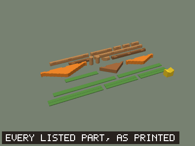

> **Only the notch fit has been test-printed.** Two crossed 1-notch logs in PLA fit well at the current notch width. The six example buildings are checked in software for overlap, support and interlocking, but nobody has printed a whole building yet. Do the [fit test](#2-print-the-fit-test) on your own printer before printing a full set.

## Contents

- [Quick start](#quick-start)
- [The parts](#the-parts): [roof parts](#roof-parts) and [four log sets](#log-sets)
- [How to print](#how-to-print): [get the files](#1-get-the-files), [fit test](#2-print-the-fit-test), [slice](#3-slice), [print a building](#4-print-a-building), [assemble](#5-assemble)
- [Example buildings](#example-buildings)
- [Editing the parts](#editing-the-parts)
- [Status](#status)
- [More documentation](#more-documentation)
- [Legal](#legal)

## Quick start

1. **Pick a log set.** There are [four finishes](#log-sets) of the same 10 logs. Every building also uses the [roof parts](#roof-parts).
2. **Download** the repository (**Code > Download ZIP**), or single files from the [parts catalogue](PARTS.md).
3. **Print the [fit test](#2-print-the-fit-test)**: three small parts that show whether the notches suit your printer.
4. **Print a building** from the [parts list](#4-print-a-building). No rotation and no supports are needed.

## The parts

Every STL is in millimetres and already lies in its printing orientation. The [parts catalogue](PARTS.md) has a picture, the size and a download link for every part.

| Logs | Half logs | Gables | Shingles | Chimney |
|:---:|:---:|:---:|:---:|:---:|
| 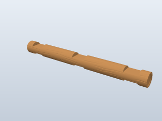 | 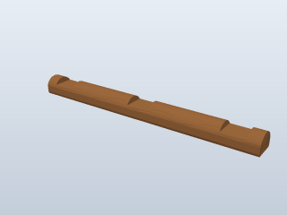 |  | 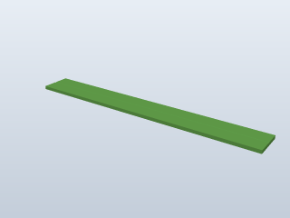 |  |
| 1 to 4 notches, 1 1/2 to 10 5/8 in | 4 1/2 and 7 1/2 in; the base course | Two stepped sizes and a plain triangle | Flat and ridge, 5 5/8 to 11 in | Sits astride the roof ridge |

The files are in five folders under `stl/`. A building needs the roof parts plus the logs from one log set.

### Roof parts

| Folder | Contents | Looks like |
|---|---|:---:|
| [`stl/roof_parts/`](stl/roof_parts) | 3 gables, 6 shingles and the chimney, plus a door and window of my own design (12 parts). Smooth, and the same whichever logs you print. [See them all](PARTS.md#roof-parts) |  |

### Log sets

Four finishes of the same 10 logs: five notched logs, two half logs, a beveled end and two solid logs. Choose one. Each set also has the longest log as [two shorter halves](#the-two-piece-4-notch-log).

| Set | Folder | Shape | Ends | Surface | Looks like |
|---|---|---|---|---|:---:|
| [**Flat-End-Round**](PARTS.md#flat-end-round) | [`stl/flat_end_round/`](stl/flat_end_round) | Round | Flat, with growth rings | Wood grain |  |
| [**Ball-End-Round**](PARTS.md#ball-end-round) | [`stl/ball_end_round/`](stl/ball_end_round) | Round | Rounded | Wood grain | 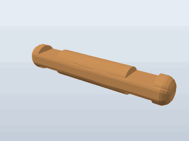 |
| [**Flat-End-Octagonal**](PARTS.md#flat-end-octagonal) | [`stl/flat_end_octagonal/`](stl/flat_end_octagonal) | Eight-sided | Flat, with growth rings | Wood grain | 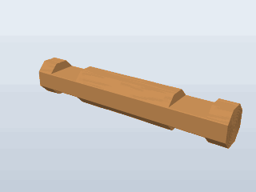 |
| [**Smooth**](PARTS.md#smooth) | [`stl/smooth/`](stl/smooth) | Round | Flat | Plain; small files |  |

- **The sets mix.** Every log is 18.25 mm wide where it sits in a notch, whichever set it comes from.
- **The grain doesn't change the fit.** It is cut into the surface, never raised.
- **File names match across sets.** Ball-end files add `_rounded` and octagonal files add `_oct`; the parts lists below use the plain names. One exception: `log_1insert_1-1_2_round` is `log_1insert_1-1_2_oct` in the octagonal set.

### The two-piece 4-notch log

The 270 mm log does not fit a 256 mm bed, so every log set also has it as two halves of 138 mm, `log_4insert_10-5_8_split_tongue` and `log_4insert_10-5_8_split_groove`. Print one of each in place of one whole log. They have not been test-printed yet.

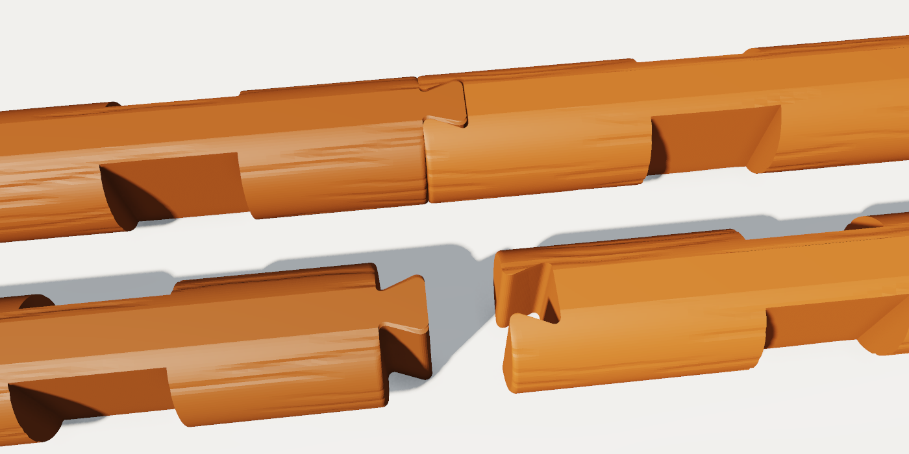

- **The joint is a dovetail,** the joint of a hewn-log cabin corner, turned to join two logs end to end. A tail on one half, wider at its tip than at its neck, sits in a matching socket in the other. It is halfway between the two middle notches, so all four notches stay where they are on the whole log.
- **It prints upright.** The dovetail is cut straight through the log from one printing flat to the other, so on the bed every face of it is a vertical wall. No supports.
- **It goes together sideways.** Slide the tail into the socket across the log, not endways. Once the log is in a wall, the dovetail stops the halves pulling apart and the logs crossing in the notches stop them sliding sideways.
- **The edges are rounded.** Every corner of the tail and the socket has a radius of about 1 mm, and so do the rims where the two pieces meet. The joint looks like the worn corner of a hewn log, and nothing sharp is left for small hands. Change the radius with `--splice-round`; `0` gives square edges.
- **The fit is loose:** 0.3 mm of clearance on each face. Change it with `--splice-clearance` (see [Regenerating the files](#regenerating-the-files)).

**Longer logs.** `log_extender_1insert_3` goes between the two halves: its socket takes the tongue half's tail, and its tail goes into the groove half. Each extender adds one notch and 3 in, so one makes a 5-notch log of 13 5/8 in (346 mm), two a 6-notch log of 16 5/8 in, and so on. The notches stay on 3 in centres.

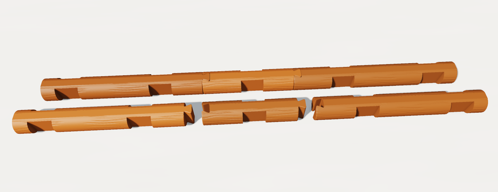

## How to print

### 1. Get the files

On GitHub, choose **Code > Download ZIP** and unzip it, or clone the repository. You only need the `stl/` folder: `roof_parts` plus one log set. To download single parts, use the links in the [parts catalogue](PARTS.md).

### 2. Print the fit test

Printers and filaments vary, so check the notch fit before printing a building. Print:

- 2 x `log_1insert_1-5_8`
- 1 x `half_log_4-1_2`

Cross the two logs at their notches, then seat one in a half-log notch. A log should seat fully and lift out freely, without rattling.

- **Too tight or too loose:** the default leaves 0.2 mm of clearance on each side (an 18.65 mm notch for an 18.25 mm log), which in PLA seated fully with a small amount of play. Change it in 0.05 mm steps with `--clearance` (see [Regenerating the files](#regenerating-the-files)) or the `Clearance` parameter in the [Fusion design](fusion/README.md).
- **PETG:** start at 0.3 mm.

### 3. Slice

Load the STLs as they are: no rotation and no supports.

| Setting | Value |
|---|---|
| Nozzle | 0.4 mm |
| Layer height | 0.2 mm. Use 0.12 to 0.16 mm to show the wood grain better |
| Walls | 2 |
| Infill | 10%, gyroid |
| Top shell layers | 4 |
| Bottom shell layers | 3 |
| Supports | None |
| Material | PLA. For PETG, use 0.3 mm clearance (step 2) |

These are the settings of the [log style sample plate](sample_print/README.md), a ready-made Bambu Studio project with two of each log style. They are chosen to save filament and have been sliced but not yet printed. For sturdier parts use 3 walls and 20 to 30% infill, which is what the notch fit test was printed with.

How each part sits on the bed:

| Part | Orientation in the STL |
|---|---|
| Round logs, beveled end | Lying on a 0.4 mm flat, notches facing sideways |
| Octagonal logs | Lying on one face, notches facing sideways |
| Half logs | Flat side down, notches up |
| Solid logs | Standing on end |
| Gables, shingles, door, window | Flat on a face |
| Chimney | Upside down: open top on the bed, V-cut facing up |

**Bed size.** Two parts are longer than a 256 mm bed: `log_4insert_10-5_8` (270 mm) and `shingle_flat_11` (279 mm). Turn them diagonally, or use a larger printer. The log also comes as [two halves](#the-two-piece-4-notch-log) of 138 mm. The next longest parts are the 9 in shingles (229 mm) and the 3-notch log (194 mm).

**Ball-end logs.** The last 1.5 mm of each end lifts slightly off the bed, a small overhang that is meant to print without supports.

### 4. Print a building

How many of each part the six [example buildings](#example-buildings) need. Logs come from your log set; gables, shingles and the chimney come from `roof_parts`.

| Part | Cabin | Shed | Cottage | Porch cabin | Tall house | Watchtower |
|---|:---:|:---:|:---:|:---:|:---:|:---:|
| **Footprint** | 6 x 9 in | 3 x 6 in | 3 x 6 in | 6 x 6 in + porch | 6 x 6 in | 3 x 3 in |
| `half_log_7-1_2` | 2 | | | 3 | 2 | |
| `half_log_4-1_2` | | 2 | 2 | | | 2 |
| `log_4insert_10-5_8` | 8 | | | 2 | | |
| `log_3insert_7-5_8` | 3 | 8 | 8 | 9 | 14 | |
| `log_2insert_4-1_2` | 3 | 6 | 6 | 3 | 8 | 21 |
| `log_1insert_1-5_8` | 1 | | | 12 | 3 | 10 |
| `log_1insert_1-1_2_round` | 2 | | | 3 | 5 | |
| `gable_plastic_8-1_2` | 2 | | | 2 | 2 | |
| `gable_plastic_small_2notch` | | | 2 | | | |
| `gable_wood_triangle_4x2` | | 2 | | | | 2 |
| `shingle_flat_9` | 6 | | | 6 | 6 | |
| `shingle_ridge_9` | 2 | | | 2 | 2 | |
| `shingle_flat_6` | | 4 | 6 | | | 4 |
| `shingle_ridge_6` | | 2 | | | | 2 |
| `chimney` | 1 | | 1 | 1 | 1 | |
| **Total** | **30** | **24** | **25** | **43** | **43** | **41** |

- **Easiest first builds:** the shed, cottage and watchtower. Their longest part is 194 mm or less. The cabin and porch cabin need the 270 mm logs.
- **The 1-notch logs are interchangeable,** so any mix of them works.
- **Colours close to the originals:** brown logs, orange stepped gables, a yellow chimney, and green, yellow, orange or red shingles.

### 5. Assemble

1. Lay two **half logs** flat side down as the end walls. They are the only parts that touch the table.
2. Cross two side-wall logs over them, notch into notch.
3. Keep alternating end walls and side walls. Each course adds 3/8 in. Use the short 1- and 2-notch logs to leave gaps for a door or window.
4. Set a gable where the next end-wall log would go, its bottom notches over the side-wall logs.
5. Lay shingles across the two gables from the eave upward, then drop the chimney over the ridge. The chimney fits the stepped gables only; the triangle's roof is steeper.

## Example buildings

Six buildings made from these parts. The cabin, shed and cottage are in the animation at the top of the page. All six pass the same [software check](DESIGN_NOTES.md#what-verifymjs-checks).

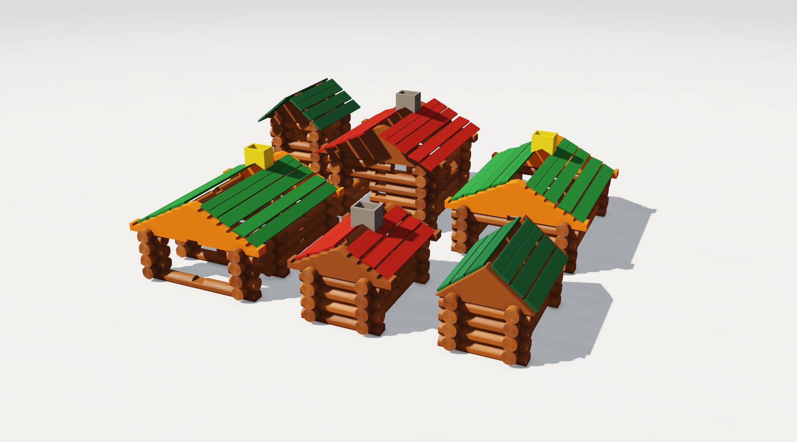

| Porch cabin, smooth logs | Tall house, wood-grain logs |
|:---:|:---:|
| 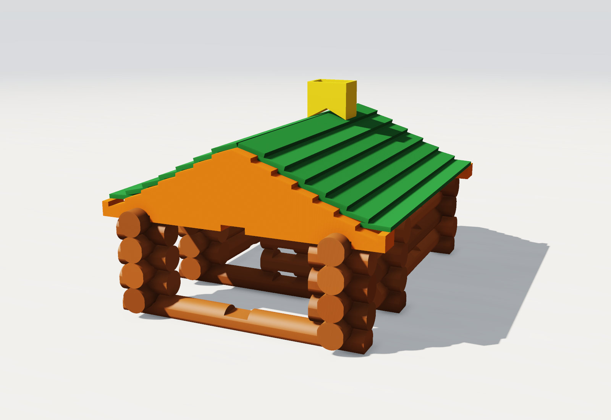 | 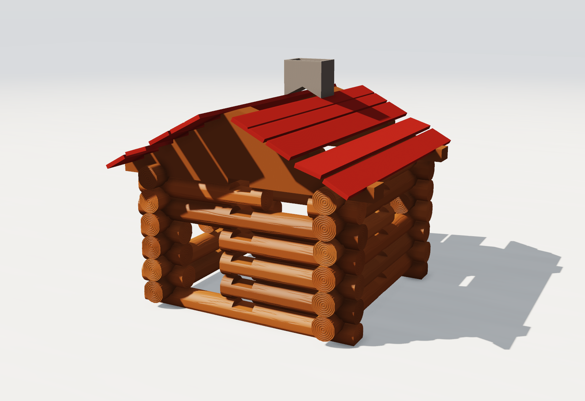 |
| 6 x 6 in room; the roof runs forward over a 3 in porch on two posts of crossed 1-notch logs | 6 x 6 in and 12 courses, with a doorway three logs high, a window in every wall and the roof overhanging both gables |

The same corner in both finishes, and the watchtower (3 x 3 in, 14 courses):

| Smooth | Wood grain | Watchtower |
|:---:|:---:|:---:|
| 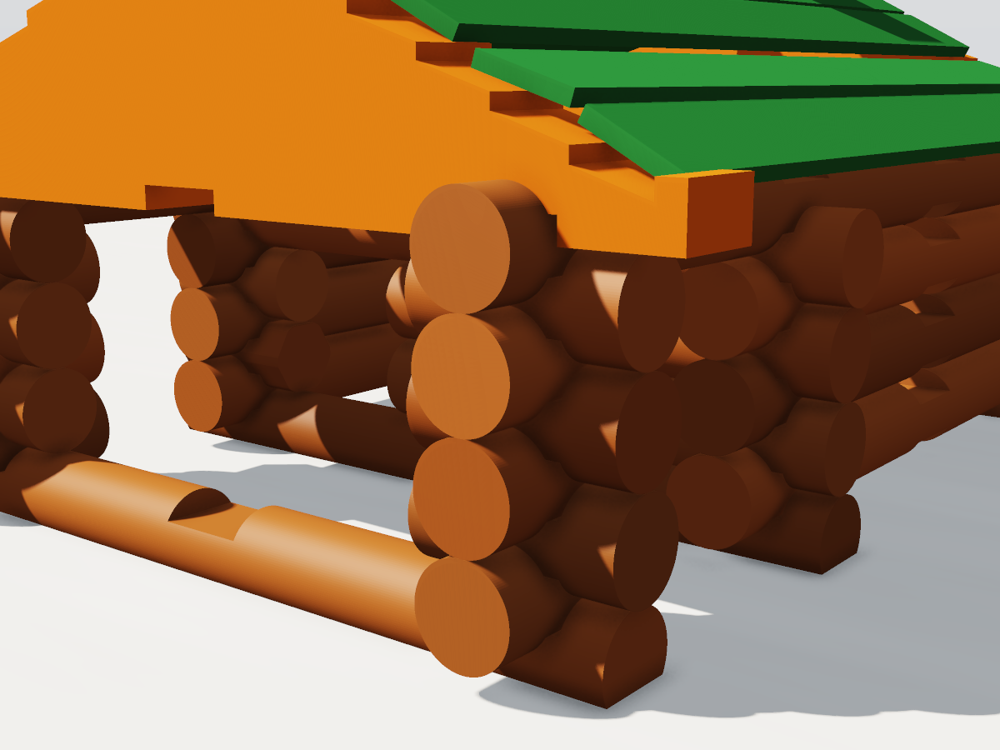 | 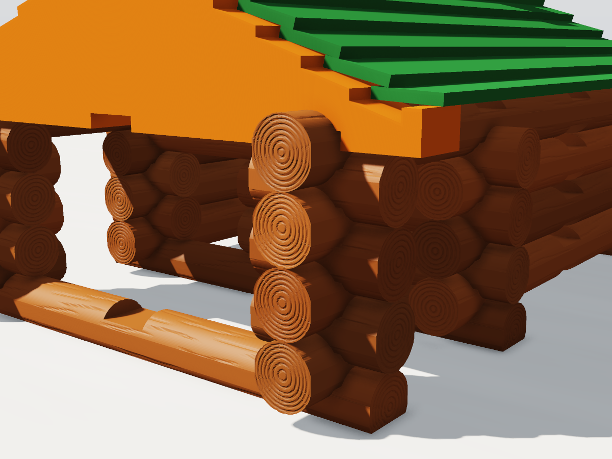 | 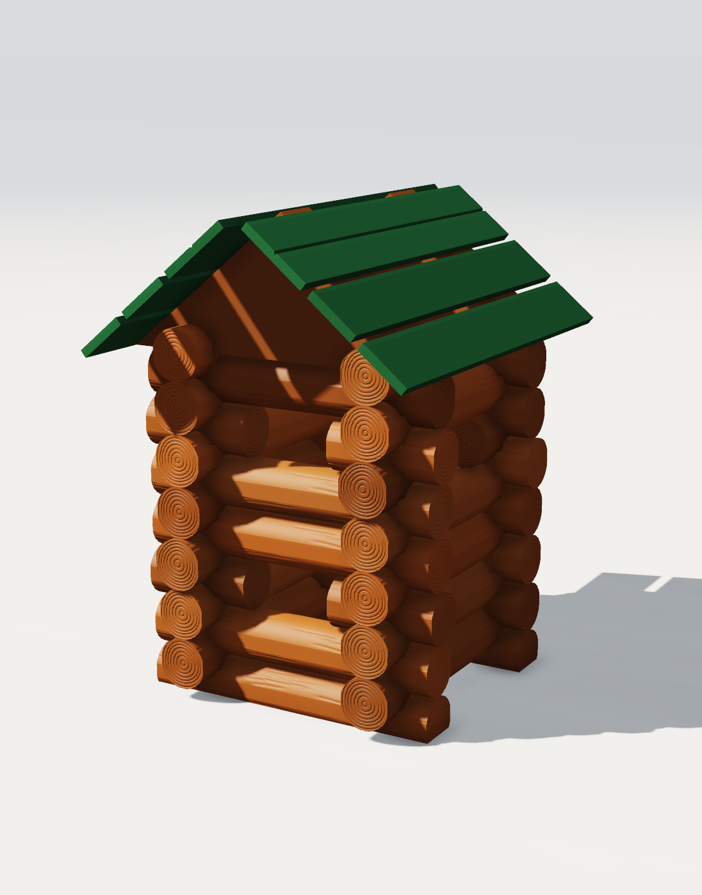 |

Each cabin is also rendered in the other finish: [porch cabin, wood grain](images/examples/porch_cabin_woodgrain.png) and [tall house, smooth](images/examples/tall_house_smooth.png).

And the porch cabin in a setting its size doesn't deserve:

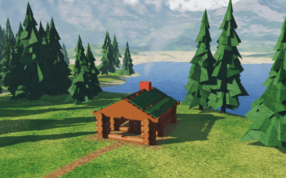

The logs in these pictures are the exact STL geometry. The colours are a suggestion, and the meadow, pines, lake and mountains are generated by `make_landscape_gif.mjs`.

## Editing the parts

**In Fusion.** [`fusion/`](fusion) holds one Autodesk Fusion design per folder in `stl/`, with every size a named parameter. See [fusion/README.md](fusion/README.md).

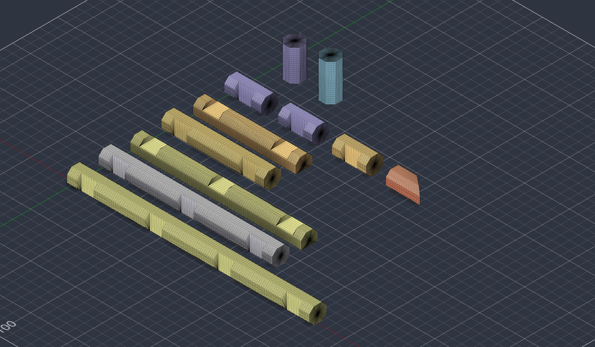

**In code.** All geometry is defined in `parts.mjs`.

### Regenerating the files

Requires [Node.js](https://nodejs.org); there is nothing to install. From this folder:

```bash
node log_generator.mjs
```

This rewrites all five `stl/` folders and checks that every mesh is watertight and sits on the bed. Options:

| Option | Default | Meaning |
|---|---|---|
| `--clearance` | `0.2` | Gap on each side between a notch and the part sitting in it, in mm |
| `--flat` | `0.8` | Total width taken off round logs, in mm, as an equal flat on each side. The parts that sit in notches are narrower by this much, and the notches follow |
| `--splice-clearance` | `0.3` | Gap on each face of the dovetail between the pieces of the two-piece log, in mm |
| `--splice-round` | `0.8` | Radius on the edges of that dovetail, in mm. `0` leaves them square |
| `--set` | `all` | `all`, or one folder: `roof_parts`, `ball_end_round`, `flat_end_round`, `flat_end_octagonal` or `smooth` |
| `--out` | `stl` | Parent folder for the five folders |

For example, for PETG:

```bash
node log_generator.mjs --clearance 0.3
```

The other scripts:

| Command | What it does |
|---|---|
| `node verify.mjs` | Checks the six buildings with flat-end round logs and writes `VERIFY_flat_end_round.md`. Exits non-zero if parts overlap or a part is unsupported |
| `node verify.mjs --set <set>` | The same with `ball_end_round`, `flat_end_octagonal` or `smooth` logs; writes `VERIFY_<set>.md` |
| `node make_gif.mjs` | Renders `cabin_build.gif` |
| `node make_renders.mjs` | Renders the stills of the example buildings into `images/examples/` |
| `node make_landscape_gif.mjs` | Renders `images/examples/cabin_landscape.gif` and a still of the same scene (takes a few minutes) |
| `node make_part_images.mjs` | Renders a still and a rotating image of each part into `images/<set>/`, for the roof parts and all four log sets. `--set <folder>` renders one set |

## Status

| | |
|---|---|
| **Checked in software** | In all six buildings no parts overlap, every part is supported and every wall log is locked by its notches, with each of the four log sets |
| **Test-printed** | The notch fit only. Pairs of 1-notch logs were printed in PLA with notches from 18.65 to 19.65 mm wide; 18.65 mm fit best and is the default ([details](fit_test/README.md)) |
| **Not checked** | Everything else in the real world. No octagonal or ball-end log, half log, gable, shingle, chimney or whole building has been printed |

If you print these, the most useful things to report are:

1. The clearance that gave a good fit, with your printer and material.
2. Whether shingles settle on the gables as in the animation, and whether the chimney sits on a stepped-gable ridge.
3. If you own original pieces: their gable thickness, shingle thickness and chimney depth. These three are assumptions (see [DESIGN_NOTES.md](DESIGN_NOTES.md#limits)).

## More documentation

| File | Contents |
|---|---|
| [PARTS.md](PARTS.md) | Parts catalogue: a picture, the size and an STL link for every part |
| [DESIGN_NOTES.md](DESIGN_NOTES.md) | How each part was measured, what is assumed, the wood texture, and how the buildings are verified |
| [fusion/README.md](fusion/README.md) | The Fusion designs and their parameters |
| [fit_test/README.md](fit_test/README.md) | The notch fit test print and its result |
| [sample_print/README.md](sample_print/README.md) | The log style sample plate, the dovetail splice sample plate and their print settings, plus an earlier plate comparing standing and lying logs |
| [PARTS_SPEC.md](PARTS_SPEC.md) | The pieces sold commercially since 1916, with dimensions and confidence |
| [RESEARCH.md](RESEARCH.md) | Sources: existing models, original dimensions, printing tolerances |
| Verification results | Per-part results for each log set (generated): [flat-end round](VERIFY_flat_end_round.md), [ball-end round](VERIFY_ball_end_round.md), [flat-end octagonal](VERIFY_flat_end_octagonal.md), [smooth](VERIFY_smooth.md) |

## Legal

"Lincoln Logs" is a Hasbro trademark; this project is not affiliated with Hasbro. The 1920 patent has expired, so the geometry is free to copy. If you share or sell the files or prints, call them "compatible log-cabin logs".
