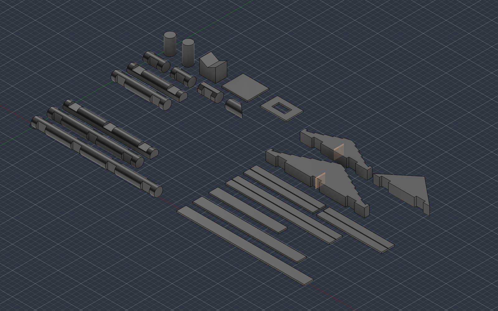
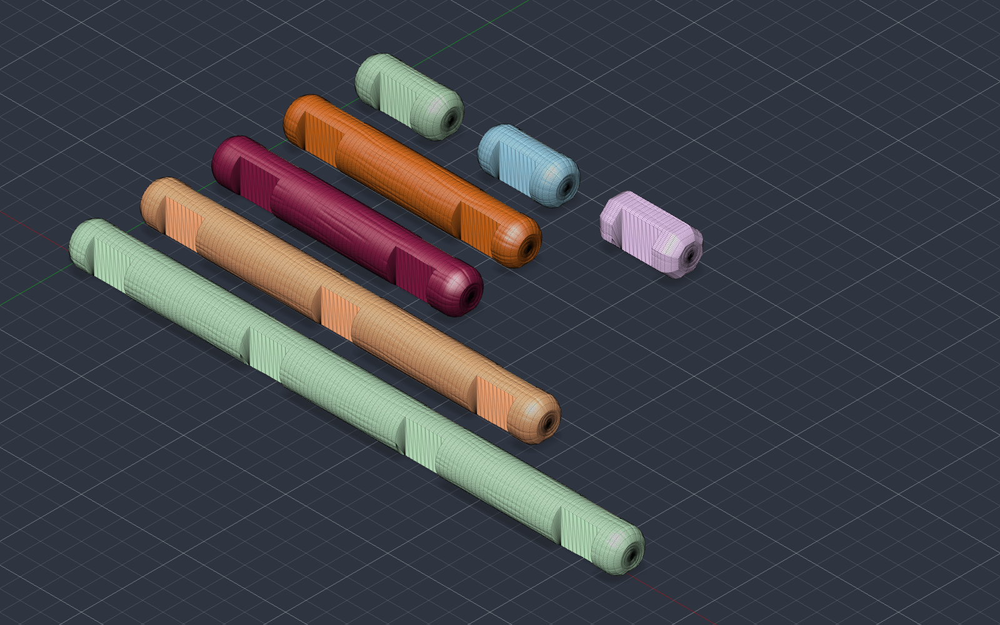

# Fusion design

Every part in `parts.mjs` as an editable, parametric Autodesk Fusion design. The three files match the three STL sets: smooth (`stl/smooth/`), wood grain (`stl/woodgrain/`) and the rounded-end logs (`stl/rounded_woodgrain/`). To print without Fusion, use the STLs; see the [main README](../README.md#how-to-print).

| File | What it is |
|---|---|
| `DeadPresidentTreeSections.f3d` | Smooth version: the parametric design, exported from the Fusion document of the same name. In Fusion: File > Open > Open from my computer |
| `DeadPresidentTreeSections_woodgrain.f3d` | Wood-grain version: a copy of the design with the textured log meshes from `stl/woodgrain/` added (see "Wood-grain copy" below) |
| `DeadPresidentTreeSections_rounded_woodgrain.f3d` | Rounded-end logs only: the 7 notched logs with rounded ends, as parametric solids plus the textured meshes from `stl/rounded_woodgrain/` (see "Rounded-end logs" below) |
| `build_lincoln_logs.py` | The script that built the parametric solids. Run it to rebuild from scratch: Utilities > Add-Ins > Scripts and Add-Ins > + > pick this folder. Set `PART_SET = 'rounded'` at the top to build the rounded-end logs instead |
| `layout.png`, `layout_rounded.png` | Pictures of the two layouts |

## How it is organised

- **One component per part**, named like the STL (`log_3insert_7-5_8`, `chimney` ...). The timeline has one group per part.
- **Every size is a user parameter** (Modify > Change Parameters). Sketch dimensions and feature distances are expressions of those parameters, and every sketch is fully constrained.
- **Each body is in its printing orientation**, sitting on Z = 0: round logs on their two equal flats with notches sideways, half logs flat side down, gables and shingles flat, solid logs standing, the chimney upside down.

## Shared parameters

Change one and every part follows.

| Parameter | Default | Meaning |
|---|---|---|
| `LogDia` | 0.75 in | Log diameter |
| `NotchDepth` | 0.1875 in | Notch depth, each side |
| `NotchCenters` | 3 in | Spacing between notch centres |
| `Clearance` | 0.2 mm | Fit clearance per side (try 0.3 mm for PETG) |
| `PrintFlat` | 0.8 mm | Total width taken off a round log, split into an equal 0.4 mm flat on each side. The bed side is one of them. (The `.f3d` exports still show the earlier one-sided flat) |
| `MateWidth` | `LogDia - PrintFlat` | Width of a log, half log or gable where it sits in a notch (18.25 mm) |
| `NotchWidth` | `MateWidth + 2 * Clearance` | Notch width (18.65 mm) |
| `CourseRise` | `LogDia - 2 * NotchDepth` | Height gained per crossing course |
| `HalfLogHeight` | `LogDia - NotchDepth` | Half-log height |
| `GableThk` | `MateWidth` | Gable thickness |
| `ShingleThk`, `FlatShingleWidth`, `RidgeShingleWidth` | 0.125, 0.8, 1.125 in | Shingle sizes |
| `RidgeGrooveWidth`, `RidgeGrooveDepth` | 1.6, 0.8 mm | Ridge shingle groove |
| `PanelThk` | 0.125 in | Door and window thickness |
| `PlasticRoofAngle` | from the large gable (27.1 deg) | The small gable's height and the chimney's V follow it |

## Per-part parameters

Each part's parameters start with its code.

| Code | Component | Main parameters |
|---|---|---|
| `L1a`, `L1b`, `L1oct` | `log_1insert_1-5_8`, `log_1insert_1-1_2_round`, `log_1insert_1-1_2_octagonal` | `_Length`, `_Notches` |
| `L2a`, `L3`, `L4` | `log_2insert_4-1_2`, `log_3insert_7-5_8`, `log_4insert_10-5_8` | `_Length`, `_Notches` |
| `BevShort` | `beveled_end_1-1_2` | `_Length`, `_Angle` |
| `Half2`, `Half3` | `half_log_4-1_2`, `half_log_7-1_2` | `_Length`, `_Notches` |
| `Solid1`, `Solid2` | `solid_log_1-3_8`, `solid_log_1-5_8` | `_Length` |
| `GableL`, `GableS` | `gable_plastic_8-1_2`, `gable_plastic_small_2notch` | `_Width`, `_Height`, `_Steps`, `_Notches`, `_EaveHeight`, `_LipThk`, `_LipHeight`, `_Riser` |
| `GableTri` | `gable_wood_triangle_4x2` | `_Width`, `_Height`, `_Notches` |
| `ShFlat6`, `ShFlat9`, `ShFlat11` | `shingle_flat_*` | `_Length` |
| `ShRidge5`, `ShRidge6`, `ShRidge9` | `shingle_ridge_*` | `_Length` |
| `Chimney` | `chimney` | `_Width`, `_Depth`, `_Height`, `_Wall`, `_Pocket` |
| `Door`, `Window` | `extra_door`, `extra_window` | `_Courses`, plus `_OpeningWidth`, `_OpeningHeight` on the window |

Notes:
- Notches stay centred on the part: set `_Notches` and `_Length` and the row re-centres.
- `_FirstNotch`, `_NotchStep`, `_StepRun`, `_TreadRise`, `_StepPitch` and `Chimney_VDepth` are derived. Leave them alone.
- `_NotchStep` exists because Fusion cannot pattern a single copy. The notch pattern always makes at least two; with one notch the step drops to 0.001 mm so the second copy lands on the first.
- `GableS_Height` is an expression that keeps the large gable's pitch. Type a number over it to set the height directly.

## Wood-grain copy

`DeadPresidentTreeSections_woodgrain.f3d` is the same design with one mesh body added to each of the 11 log components (notched logs, half logs, beveled pieces, solid logs), named `<part>_woodgrain`. Each mesh is the textured STL from `stl/woodgrain/`, sitting exactly where the smooth solid is.

- The smooth parametric solids are still there, hidden. Turn on a body's eye icon to see it.
- The meshes are imported, not parametric: changing `LogDia`, a `_Length` or any other parameter moves the solid but not the mesh. After a change, regenerate the STLs with `node log_generator.mjs` and re-insert the ones from `stl/woodgrain/` (Insert > Insert Mesh).
- Gables, shingles, the chimney and the extras have no texture and are unchanged.
- To print a textured log from here: right-click the mesh body > Save As Mesh. It is the same geometry as the file in `stl/woodgrain/`.

The grain itself is generated by `parts.mjs`; `build_lincoln_logs.py` builds only the smooth design.

## Rounded-end logs

`DeadPresidentTreeSections_rounded_woodgrain.f3d` holds only the rounded-end set: one component per log, named like the STLs in `stl/rounded_woodgrain/` (`log_3insert_7-5_8_rounded` ...).

- **Parametric solids**, hidden, built by `build_lincoln_logs.py` with `PART_SET = 'rounded'`. They use the shared log parameters (`LogDia`, `NotchDepth`, `NotchCenters`, `Clearance`, `PrintFlat`, `MateWidth`, `NotchWidth`, `CourseRise`), plus `EndRadius` (4 mm), which rounds the ends of every log at once. Per-log codes are `R1a`, `R1b`, `R1oct`, `R2a`, `R2c` (4 3/4 in), `R3` and `R4`, each with `_Length` and `_Notches`.
- **Wood-grain meshes**, visible, named `<part>_woodgrain`: the STLs from `stl/rounded_woodgrain/`, sitting exactly where the solids are. As in the wood-grain copy, they don't follow parameter changes.
- The solids round the ends with a 4 mm fillet; the meshes use the STLs' three-step taper (`ROUNDED_ENDS` in `parts.mjs`). So the solid and the mesh differ slightly at the very ends.

## Making a new part

Copy a component (right-click > Copy, then Paste New), or add an entry to the lists at the top of `build_lincoln_logs.py` (for example a 5-notch log: `('L5', 'log_5insert', '13.625 in', 5, 'round')`, plus a position in `LAYOUT`) and run the script again.

## Printing

Right-click a component's body > Save As Mesh (3MF or STL). Bodies are already oriented for the bed, so no rotation is needed in the slicer. Slicer settings are in the [main README](../README.md#3-slice).

## Differences from the STLs in `stl/smooth/`

Volumes and bounding boxes were compared with every STL. All match, with one expected difference:
- Round parts are true cylinders here; the STLs are 144-sided, so the Fusion volumes are about 0.03% larger.
