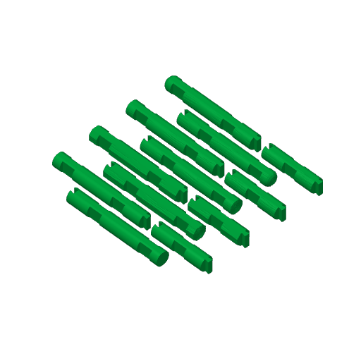
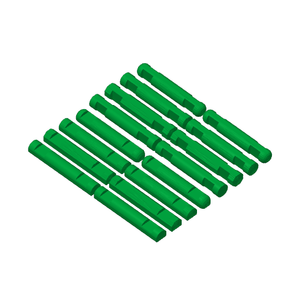

# Sample plates (P2S)

Three Bambu Studio projects for a Bambu Lab P2S, 0.4 mm nozzle, Bambu PLA Basic, Cool Plate.

## Dovetail splice sample

**This plate holds the first, loose version of the joint** (0.3 mm clearance on every face). Printed, its pieces went together freely but sagged at every joint. The STLs in `stl/` now have a press fit; the plate has not been rebuilt from them, so load the new STLs into Bambu Studio with the settings below.

`dovetail_p2s.3mf` prints every dovetail piece: the tongue half and groove half of the two-piece `log_4insert_10-5_8`, and the `log_extender_1insert_3`, from each of the four log sets. That is 12 parts on one plate, all lying on their flats as in the STLs. `dovetail_p2s_Dovetail pieces.gcode.3mf` is the same plate already sliced, ready to send to the printer.

Rows run from the back of the bed to the front. Each set takes two rows: the tongue half beside its extender, then the groove half. The sets are in this order: Ball-End-Round, Flat-End-Round, Flat-End-Octagonal, Smooth.

The settings use less filament than the log style sample and print faster:

| Setting | Value | Log style sample |
|---|---|---|
| Layer height | 0.24 mm (first layer 0.2 mm) | 0.2 mm |
| Walls | 2 | 2 |
| Infill | 8%, gyroid | 10%, gyroid |
| Top shell layers | 4 | 4 |
| Bottom shell layers | 3 | 3 |
| Outer wall and top surface speed | 250 mm/s | 200 mm/s |
| Top surface acceleration | 4000 mm/s² | 2000 mm/s² |
| Gap infill speed | 300 mm/s | 250 mm/s |
| Supports | None | None |
| Brim | Auto | Auto |

Bambu Studio's CLI estimates about 3 h 50 min and about 130 g. With the log style sample's settings the same plate comes to about 4 h 36 min and 137 g. Lightning infill would cut it to about 3 h and 100 g but leaves the parts weak inside. The walls and infill are flow-limited (21 mm³/s for PLA Basic), so faster speed settings would not shorten the print much.

Bambu Studio warns that a round groove half has floating regions. These are the inner edges of the tines, which lift up to 0.3 mm off the bed (see [DESIGN_NOTES.md](../DESIGN_NOTES.md)); the warning appears with the older settings too. Expect a slight droop under the tines.

## Log style reference sample

`log_styles_p2s.3mf` prints two of each kind of log from every log set, to compare the four styles side by side and to cross the pairs at their notches. It holds 16 parts on one plate, all in their STL orientation: logs lying on their flats, base logs flat side down. Nothing stands on end and nothing needs support.

Rows run from the back of the bed to the front, two parts in each:

| Rows | Part | Sets, in order |
|---|---|---|
| 1 to 4 | `log_2insert_4-1_2` (2 notches, 4 1/2 in) | Ball-End-Round, Flat-End-Round, Flat-End-Octagonal, Smooth |
| 5 to 8 | `base_log_4-1_2` (4 1/2 in) | Ball-End-Round, Flat-End-Round, Flat-End-Octagonal, Smooth |

The print settings are chosen to save filament:

| Setting | Value |
|---|---|
| Layer height | 0.2 mm |
| Walls | 2 |
| Infill | 10%, gyroid |
| Top shell layers | 4 |
| Bottom shell layers | 3 |
| Supports | None |
| Brim | Auto |

Bambu Studio's CLI estimates about 5 h 19 min and about 166 g. With the fit test's 3 walls, 25% grid infill and 5 top layers the same plate comes to about 6 h and about 246 g. The plate has been sliced but not yet printed.

## Standing and lying comparison (earlier)

`log_sample_p2s.3mf` is the earlier sample that compared logs printed standing on end with logs printed lying down. Standing logs have since been dropped, so use it only for reference. It has the same settings as the notch fit test: 0.2 mm layers, 3 walls, 25% infill, no slicer supports. Bambu Studio's CLI estimates about 3 h 28 min and about 105 g.

| Object | Source | Orientation | Finish |
|---|---|---|---|
| V1 `log_1insert_1-5_8` | branch `vertical-print-logs` | standing | smooth |
| V2 `log_1insert_1-5_8` | branch `vertical-print-logs` | standing | wood grain |
| V3 `log_2insert_4-1_2` | branch `vertical-print-logs` | standing, 114 mm tall | wood grain |
| V4 `log_1insert_1-1_2_hex` | branch `vertical-print-logs` | standing | wood grain |
| V5 `log_1insert_1-5_8_rounded` | branch `vertical-print-logs` | standing | rounded-end wood grain |
| H1 `log_1insert_1-5_8` | branch `lying-equal-flats` | lying | smooth |
| H2 `log_1insert_1-5_8` | branch `lying-equal-flats` | lying | wood grain |
| H3 `log_2insert_4-1_2` | branch `lying-equal-flats` | lying | smooth |
| H4 `log_2insert_4-1_2` | branch `lying-equal-flats` | lying | wood grain |
| H5 `base_log_4-1_2` | branch `lying-equal-flats` | flat side down | wood grain |

The standing logs (V) have a 5 mm brim set on each object; the lying parts use auto brim. The standing logs carry break-away support combs in their notches.

**The two sets do not cross-fit.** Standing logs are full 19.05 mm rounds with 19.45 mm notches; lying logs are 18.25 mm across the flats with 18.65 mm notches. Fit-test V parts with V parts and H parts with H parts.
